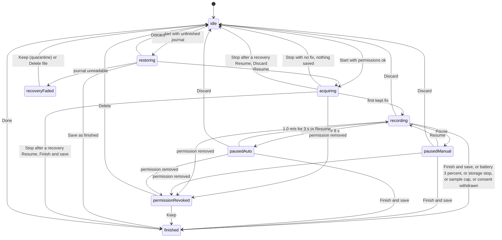

# S04-D UI design contract: GPS permission and recording-state contract

Status: DRAFT revision 2 (round 1 remediation, see the last section) for review, not approved. Date: 2026-10-17. Authoring role: ui-designer. Branch `phase2/s04-docs`. Documentation only: no code is changed and nothing was run. Roadmap row: S04-D (`docs/phase2/plan/03_ROADMAP_AND_SPRINTS_2026-10-15.md` lines 88-89).

Purpose: the single screen-and-state contract that the S04 build implements ("S04 builds only this", Roadmap line 88) and that the S04 test plan maps to. It is shared by EXPLORE and RIDE. It designs the permission journey, the recording states, the stop/save/discard/recovery screens, the battery guard, the privacy-zone default entry, the accessibility behaviour, the behaviour on the five S03 device families, and the join with the S03 shell strip and Record sheet. It does not design maps, routes, summaries beyond the minimum, sharing, or the EXPLORE and RIDE journeys (S05-D, S06-D, S10-D).

Labels: FACT = read in a repository file (path given). INFERENCE = concluded from facts. PROPOSED = a number or rule invented here (a number cited from `S04_REQUIREMENTS.md` keeps the PROPOSED status it has there; both become binding only when the product-owner and the operator accept them). DECISION NEEDED (DN-n) = an open product choice with options in words (section 22). UNGROUNDED = could not be verified in the repository (section 23). NOT_RUN = needs a device or a console. S04-R-nnn = a requirement id of `S04_REQUIREMENTS.md`; GPS-PRIV-nnn = an id of the privacy contract. Copy tables give Russian and English: Russian is the default and first-checked locale (S03D F20), and the Russian strings are product user-facing text; all other prose is English.

## 1. Sources read

| Source | Used for |
|---|---|
| `docs/phase2/s03/S03D_UI_DESIGN_CONTRACT.md` | Format, tokens (`HudTokens`, `HudPanel`, `HudButton`, `HudChip`, `HudSheet`, `HudSettingRow`), strip and Record sheet (S-4, S-5), size classes (10.1), five device families (10.2, 10.8), accessibility (12), copy budgets (13) |
| `docs/phase2/s04/S04_REQUIREMENTS.md` | Every requirement S04-R-001..051, assumed defaults A-1..A-8, open questions 1-8 |
| `docs/phase2/s04/S04_ANDROID_PLATFORM_STUDY.md` | Foreground-service and permission facts, notification behaviour, what a kill allows |
| `docs/phase2/s04/S04_DOC_READINESS.md`, `S04_STORIES.md` | Gaps G1, G7, G9; story ids S04-17, S04-25 that consume this contract |
| `docs/phase2/plan/04_UI_UX_DIRECTION_2026-10-15.md` | Motion rule (no bracket or scan-line motion on live recording screens), no modal while recording, permission at the Start tap with a one-line reason, section 7.1 state list |
| `docs/phase2/s01/GPS_LOCATION_PRIVACY_CONTRACT.md` | GPS-PRIV-005..011, 046, 048 |
| `mobile/lib/shared/widgets/dock_widgets.dart`, `features/workouts/state/active_session_status.dart`, `features/modes/widgets/record_sheet.dart` | Code the strip and sheet join (read only) |

## 2. Facts this contract builds on

| # | Fact | Evidence |
|---|---|---|
| F1 | `ActiveSessionKind` has one value, `gymWorkout`; `ActiveSessionState` has four (running, paused, resting, restFinished); the derive function lets the set timer win; the owner slot is written only by the workout page; the code comment promising that a new source needs no strip change was found false by the S03 review. | FACT `active_session_status.dart` 63-80, 245-290; Readiness addendum |
| F2 | `RecordingStrip` renders state icon, state word, optional title, a mode label and a clock; its semantics label is "state, title, mode, whole minutes" with a hint; the seconds tick is outside the semantics; one tap navigates to `destination` with no modal. `RailRecordSlot` reserves 64 dp (compact) or 56 dp (extended) and shows a short state word plus whole minutes. `RecordPill` is 48 dp high. | FACT `dock_widgets.dart` 140-480 |
| F3 | `openRecordSheet` does nothing while `activeSessionStatusProvider` is non-null; `recordRowsFor` returns no rows for ride and explore; rows are `HudSettingRow` 56 dp high with `recordSheet.row.<id>` keys; a refused row is disabled with its reason in the semantics hint; opening the sheet performs no write. | FACT `record_sheet.dart` 75-115, 133-145, 218-243 |
| F4 | RIDE and EXPLORE are "coming later" in S03 and cannot be selected. Pushed routes sit outside the shell, so neither strip nor rail is visible on them. Process death clears the gym timers and S03 makes no recovery claim. | FACT S03D 4.1, F5, R-S5 |
| F5 | The app has no location package, no foreground service, no location permission in the manifest; `permission_handler` and `flutter_local_notifications` are declared; `POST_NOTIFICATIONS` is declared. | FACT Platform study section 1 |
| F6 | A `location`-type foreground service started while the app is visible keeps working with the screen off without `ACCESS_BACKGROUND_LOCATION` (high-confidence INFERENCE, needs a device); a restart after a kill cannot resume location from a hidden state without it. | Platform study 2.8, 3.7, 3.8 |
| F7 | From Android 11 foreground and background location are separate requests; the system dialog has no "all the time" button, it opens a settings page; approximate-only is a legal grant; downgrading to approximate restarts the process. | FACT Platform study 3.2-3.5, 3.9 |
| F8 | Without `POST_NOTIFICATIONS` the foreground service can still launch (permission not needed) but the notification shows only in the Task Manager, not the drawer; whether the service keeps running after denial is implied, not stated. | FACT 3.11; INFERENCE/NOT_RUN 3.12 |
| F9 | A revocation from system settings while recording is not documented as a callback; the app learns by a permission check or a process restart. | UNKNOWN, Platform study 3 (end), NOT_RUN |
| F10 | No connectivity package and no global offline indicator exist. No manual activity entry screen exists in `mobile/lib` (search for manual entry names found nothing). | FACT S03D F7; search of `mobile/lib` |
| F11 | The five S03 device families are Android phone, iPhone, iPad, Android tablet and MacBook; only an Android platform folder exists; Apple families are design only (NOT_RUN). S04 is Android only (A-1). | FACT S03D F26, 10.2, 10.8; S04-R-050 |
| F12 | Existing announcements use `SemanticsService.announce` with a text direction; no call passes an assertiveness value (UNGROUNDED whether the pinned Flutter version supports one). | FACT grep of `mobile/lib` (one file found) |

## 3. Principles for this contract

1. Reuse the HUD primitives and tokens of S03D; no new colour, blur radius or type family. Status is always word plus icon, never colour alone. `warning` and `danger` are never text or the only signal (S03D F10, 12).
2. The recording screen is glanceable and quiet: no bracket or scan-line motion, no looping animation of any kind, no indeterminate progress indicator, no modal dialog, bottom sheet or snackbar that needs a response while a recording is active. The only modal is the operating-system permission dialog, which can appear only before a recording starts (Start flow, section 6).
3. Permission is asked only at the Start tap, after a pre-prompt of one reason line (the privacy line stays on screen beside it, RS-2), never at launch, in onboarding, in the chooser, in the Record sheet, or on opening the Start screen (S04-R-021, GPS-PRIV-005).
4. Every denial path leaves the app usable: manual entry, history and the rest of the app remain (S04-R-023, GPS-PRIV-008). No loop: at most one system request per tap.
5. Honest data: missing is "No data", never zero; a gap is a gap; no distance is invented across it (S04-R-009). Copy never claims a recovery that was not verified (S04-R-039).
6. The recording never depends on the network or on a map (S04-R-005); offline is reassurance, not an error.
7. Starting, pausing and stopping change nothing about the selected mode, and a mode change never touches a recording (S03D R-M1).

## 4. Surfaces and journeys

### 4.1 Surface inventory (every S04 screen maps to one row; S04-R-040)

| Id | Surface | Kind | Reached from |
|---|---|---|---|
| S4-1 | Start screen (sport, auto-pause, privacy line, permission panels) | Pushed route outside the shell | Record sheet row `recordSheet.row.gpsStart` (DN-1) |
| S4-2 | Recording screen (live states) | Same pushed route as S4-1, same screen after Start | S4-1 after Start; strip tap; notification tap |
| S4-3 | Stop panel (finish, discard) | Inline panel on S4-2, not a dialog | Stop button |
| S4-4 | Finish screen (saved, reason, save failure) | Same route | S4-3 "Finish and save"; automatic finish |
| S4-5 | Recovery offer and recovery-failed screen; Start screen in resume mode (RS-8) | Same route | Strip, Home card, Start screen block |
| S4-6 | Permission-revoked screen (a durable pending decision, not a transient screen: it keeps a strip row and a Home card until Keep or Delete, section 13) | Same route | Revocation while recording; strip row; Home card; revoked notification |
| S4-7 | Manual entry (minimal, DN-2, section 20) | Pushed route `/record/manual` (PROPOSED) | "Add manually" from any denial panel |
| S4-8 | Privacy-zone default row | Row in Settings, Privacy section | Settings |
| S4-9 | Strip and rail-slot GPS variants, Home recovery card, revoked-decision row | Shell dock | Shell |
| S4-10 | Persistent system notification (public and private versions), the revoked-notification, the automatic-stop notification, the engine-detached text | Android notification | Foreground service |
| S4-11 | Consent withdrawal row (S04-R-054, X4) | Row in Settings, Privacy section, next to S4-8 | Settings |

Route name for S4-1..S4-6: `/record/gps` (PROPOSED; one pushed route, no new shell tab path or sheet flag, S04-R-040).

### 4.2 Journeys

- JP-1 First Start, everything granted: Record sheet row -> S4-1 -> Start -> pre-prompt (reason line) -> Continue -> system location dialog (precise and approximate requested together, F7) -> grant -> notification step (Android 13+) -> grant -> service starts while the screen is visible -> S4-2 acquiring. Returning user with permissions already granted: Start goes straight to S4-2. Before any step, Start requires the journal to be open, the unfinished-recording check to be complete and consent not withdrawn (S04-R-055, S04-R-054, RS-7); otherwise the panel `preparing`, `cannotStart` or `consentWithdrawn` shows.
- JP-2 Denied once: system dialog denied -> panel `deniedOnce` -> Try again (one more request) or Add manually.
- JP-3 Denied permanently ("Don't ask again" or two denials): panel `deniedForever` -> Open settings or Add manually; no request is ever sent again from this panel.
- JP-4 Approximate only: recording is refused (accuracy would fail the 30 m gate, S04-R-008, S04-R-023) -> panel `approximateOnly` -> Open settings, Add manually.
- JP-5 Location services switched off in the phone: panel `servicesOff` -> Open location settings.
- JP-6 Notification permission denied: section 7 (default refuse, variant allow).
- JP-7 Background step (CONDITIONAL, DN-4): only if the architect's device test shows the foreground service needs `ACCESS_BACKGROUND_LOCATION` (S04-R-022). Default build has no such step. If used: after the foreground grant and before the service starts, panel `backgroundAsk` (education) -> Play prominent disclosure -> separate system request that opens a settings page (F7). Decline leaves recording fully working in foreground-service mode; the only loss is no restart after a kill (F6).
- JP-8 Record: S4-2 states of section 8; leaving the screen with Back never stops the recording; the strip carries it on all five tabs.
- JP-9 Stop and save, JP-10 Discard: S4-3, S4-4, section 11.
- JP-11 Kill and recovery: next app start -> strip "Unfinished recording" plus Home card -> S4-5 -> Resume, Save as finished, or Discard; Start is blocked until chosen (S04-R-016).
- JP-12 Revocation mid-recording: S4-6, section 13. The decision is durable: until Keep or Delete the strip shows a revoked row and the Home card shows it; Start is not blocked by it (PROPOSED, the recording is already sealed and saved).
- JP-13 Battery falls: banner at 10 %, automatic save and stop at 3 % (section 10).
- JP-14 Gym timer and GPS together: section 14.
- JP-15 Account switch and sign-out (X1): the strip, the recovery offer and the journal of another account are never shown (S04-R-037b, S04-R-045). Only a confirmed different non-null uid or an explicit sign-out or deletion event ends a recording; a transient null or loading auth state changes nothing on screen (strip and S4-2 stay as they are). On explicit sign-out a running recording is stopped, sealed and handed to the owner before the scope unbinds; the sign-out warning counts an active or unfinished recording (wording is the S03 sign-out sheet's, extended by the architect). A recorder pre-unbind hook (bounded, 5 s PROPOSED) does the sealing and hand-off before unbind (Y2); if it times out the unsealed recording stays in its own scope and is not shown to any other account. A transient null keeps the recorder running with appends buffered in memory (120 s PROPOSED); past that the recording stops with the reason line `gpsReasonAccount` on S4-4 and no automatic-stop notification (Y3; the notification set is the four reasons of 17). When the "cannot check" path of the sign-out guard applies, "Sign out anyway" stays allowed with explicit text (Y5; wording belongs to the sign-out sheet, carried).
- JP-16 Start fails or hangs: Start shows the busy label, then 15 s (PROPOSED, counted from the service-start call, not from the tap) later panel `startFailed` with Try again and Add manually (RS-6).
- JP-17 Consent withdrawn: Settings row S4-11 -> withdraw -> Start blocked by panel `consentWithdrawn`, Resume refused; withdrawing during a recording stops and keeps it (section 18).

## 5. State model

### 5.1 The 13 states (exact names; S04-R-004 test compares this list)

`idle`, `acquiring`, `recording`, `poorAccuracy`, `offline`, `pausedManual`, `pausedAuto`, `background`, `restoring`, `recoveryFailed`, `batteryCritical`, `permissionRevoked`, `finished`.

Design note for the architect: the user-visible vocabulary is these 13 names. They are not mutually exclusive in time. Display model (PROPOSED, the storage shape is the architect's): one PRIMARY phase out of `idle, acquiring, recording, pausedManual, pausedAuto, restoring, recoveryFailed, permissionRevoked, finished`, plus CONDITIONS out of `poorAccuracy` (only while the phase is `recording`), `offline`, `background`, `batteryCritical` (while the phase is acquiring, recording or paused). The roadmap's "nine recording states" are acquiring, poor accuracy, offline, paused (manual and auto), background, restoring, recovery failed, battery critical, permission revoked.

Pause and conditions (UX10): `poorAccuracy` can occur only in phase `recording`. In `pausedManual` and `pausedAuto` the signal indicator still shows the real signal word, but the headline stays "Paused" or "Auto-paused" and no weak-signal announcement is made. `offline`, `background` and `batteryCritical` can occur in `acquiring`, `recording`, `pausedManual` and `pausedAuto`. A recovery-origin `acquiring` (after Resume from S4-5) is flagged `recoveredOrigin`; it shows the kept time and distance instead of a frozen `0:00` (8.3).

Internal design phases (TP-S04-2, TP-S04-3): the design phases `preparing`, `stopping` and `stoppedRevoked` are internal and never a new user-visible name. They display as the existing 13 names: `preparing` shows as `idle` (S4-1 panel `preparing`); `stopping` shows as the state it left (`recording`, `pausedManual` or `pausedAuto`) with the stop panel open, until the save completes and `finished` shows; `stoppedRevoked` shows as `permissionRevoked`. Discard goes from `recording` (or either paused phase) straight to `idle`, as drawn in 5.2, and never passes through `finished`.

### 5.2 State diagram (primary phases; conditions are listed under it)

A process kill is not a transition drawn from a live state: the next app start finds the journal and enters `restoring` from `idle` (S04-R-016). Conditions: `poorAccuracy` enters after 10 s with no kept fix and leaves on the next kept fix (S04-R-009); `offline` follows the network; `background` follows the app lifecycle; `batteryCritical` enters at or below 10 % and not charging and leaves when charging starts or the level reaches 12 % (the 12 % exit is PROPOSED hysteresis; S04-R-030 fixes only the entry).

### 5.3 Priority when states overlap (PROPOSED, resolves the S04-R-004 gap)

Three separate channels, so a lower-priority fact is never lost, only moved. Each channel shows only its single highest item.

| Channel | Order, highest first | Rule |
|---|---|---|
| Headline (one word plus icon, top of S4-2, first word of the strip) | `permissionRevoked`, `recoveryFailed`, `restoring`, `pausedManual`, `pausedAuto`, `acquiring`, `poorAccuracy`, `recording` | What the recorder is doing to the data right now. A user's own pause beats a machine pause; a pause beats a signal problem because a paused recording is not collecting distance. |
| Banner (one sentence, under the headline; strip third line) | storage write failing (S04-R-020), `batteryCritical`, manual pause longer than 30 minutes (`gpsPausedLongBanner`, S04-R-057), notification off (variant only) | Something that will end or degrade the recording soon. At most one banner; the next one shows when the first clears. |
| Chips (at most two, then "Details" row expands inline) | `offline`, `background` return note | Quiet facts that need no action. |

Overlap table (UX10; AC-D4-S-3 and AC-D4-S-15 test every row; an empty cell means the combination cannot occur):

| Phase | With `poorAccuracy` | With `batteryCritical` | With `offline` | With `background` |
|---|---|---|---|---|
| `acquiring` | not a condition here; the hint covers it | headline "Looking for GPS signal", banner battery | chip offline | chip on return |
| `recording` | headline "Weak GPS signal" | headline "Recording" or "Weak GPS signal", banner battery | chip offline | chip on return |
| `pausedManual` | cannot occur; headline "Paused" | headline "Paused", banner battery (wins over the long-pause banner) | chip offline | chip on return |
| `pausedAuto` | cannot occur; headline "Auto-paused" | headline "Auto-paused", banner battery | chip offline | chip on return |
| `restoring`, `recoveryFailed` | n/a | n/a | n/a | n/a |
| `permissionRevoked`, `finished` | the recording has ended, only that screen shows | n/a | n/a | n/a |

Worked overlaps: battery critical plus poor accuracy: headline "Weak GPS signal", banner battery. Paused manual plus offline plus battery: headline "Paused", banner battery, chip offline. Auto-pause plus a bad signal: headline "Auto-paused". Anything plus `permissionRevoked`: the recording has ended, only the revoked screen shows. Everything is also reachable as text in the "Details" row (a plain list of all active conditions), which is inline, not modal.

## 6. S4-1 Start screen and the permission journey

Layout (Compact): back arrow, `HudScreenTitle` `gpsStartTitle`; sport row C-S1 (single choice, `inMutuallyExclusiveGroup`, four chips Walk, Run, Hike, Ride; default Walk; the last used sport is remembered; PROPOSED, DN-15); `HudSettingRow` "Auto-pause" with `HudToggle` (default on for Walk, Run and Ride; for Hike it defaults to off because S04-R-012 names exactly three sports, PROPOSED, operator question 9); the privacy line (always visible, one panel, answers what/where/who, GPS-PRIV-006); the battery note when it applies; a `HudButton` primary "Start", 56 dp high, pinned to the bottom. The button label is the same on first and later runs. While a start is in progress the label becomes `gpsStarting` ("Starting...", static text, no spinner), the button reports `isEnabled == false` and the busy state is announced once (UX7, A11Y M9). In resume mode (RS-8) the title is `gpsResumeModeTitle` and the button reads `gpsRecoveryResume`.

Panels (one visible at a time in the area above the Start button; the privacy line stays visible under the panel at all times; each has a header, text and at most three buttons; keys `gps.start.panel.<id>`):

| Panel id | Shown when | Buttons (primary first) | Request sent |
|---|---|---|---|
| `preprompt` | First Start tap that needs location (no grant yet) | Continue, Not now | none until Continue |
| `preparing` | Start tapped while the journal is still opening or the unfinished-recording check is incomplete (S04-R-055) | none (static text `gpsPreparingBody`; Back only); resolves itself to the next panel or to the permission flow; after 5 s (PROPOSED, Y5) without the journal opening it becomes `cannotStart` | none |
| `cannotStart` | The journal cannot be opened or the check failed (S04-R-055) | Try again, Add manually | none |
| `startFailed` | The service did not report started within 15 s (PROPOSED) counted from the service-start call, or the start threw (UX7, Y5) | Try again, Add manually | one start per tap |
| `consentWithdrawn` | Location-recording consent was withdrawn in Settings (S04-R-054) | Open privacy settings, Add manually | none |
| `restricted` | Permission status is `restricted` (parental control or enterprise policy; the user cannot grant it; TP-S04-10) | Add manually only; Open settings is NOT offered because settings cannot lift the restriction | none |
| `deniedOnce` | System dialog denied, "ask again" still allowed | Try again, Add manually | one per tap of Try again |
| `deniedForever` | Denied and the system will not show the dialog again | Open settings, Add manually | none |
| `approximateOnly` | Only approximate granted | Open settings, Add manually | none |
| `servicesOff` | Location switched off in phone settings | Open location settings, Add manually | none |
| `notifOff` | Notification permission denied (section 7) | Allow notifications or Open settings, Add manually | one per tap |
| `noGps` | Device reports no GPS hardware (DN-13) | Add manually | none |
| `blockedByJournal` | An unfinished recording exists (S04-R-016) | Review, Add manually | none |
| `batteryTooLow` | Battery at or below 3 % and not charging (PROPOSED, consistent with S04-R-030 auto-finish) | Add manually | none |
| `backgroundAsk` | CONDITIONAL, JP-7 only | Continue, Not now | one, separate, after foreground grant |

State detail per panel: trigger above; "what the user can do" is the buttons; every panel has Back; the focus goes to the panel header when it appears; announcement is the panel header text (polite). After a system dialog returns the screen re-reads the real permission state (it never trusts the button tapped) and shows the matching panel. Exit: a grant continues the Start flow without another tap; Add manually opens S4-7; Back returns to the Record sheet origin with no recording.

Rules:
- RS-1. Opening S4-1 performs zero permission or location calls (AC-D4-P-1).
- RS-2. The pre-prompt text is one line stating the reason (`gpsPrePromptReason`) and one line asking for Precise location (`gpsPrePromptPrecise`, UX17); the persistent privacy line carries where it is stored and who sees it and is on screen in the same view as the pre-prompt, so the where-stored and who-sees facts are visible at the moment of the choice (UX5, A11Y M8; the privacy line is read after the panel header in focus order); all are marked DRAFT and carry a text version (S04-R-027; approver undecided, requirements A-7).
- RS-3. Order of calls on a first Start: pre-prompt -> location request -> notification request (Android 13+) -> service start while the screen is visible -> `acquiring` (Platform study "Suggested order").
- RS-4. The screen re-checks the permission and services state on every return to the foreground, so a user who fixed it in settings continues without leaving the screen.
- RS-5. Battery at Start: 4-10 % and not charging shows the note `gpsBatteryStartNote`; Start still works.
- RS-6. Start is disabled while a start is in progress (no double service start). Timeouts (Y5, PROPOSED), one per transition: `preparing` becomes `cannotStart` after 5 s; the start has a timeout of 15 s counted from the service-start call (not from the tap), after which panel `startFailed` shows; focus goes to its header, one polite announcement, no service is left half-started (the recorder stops it). A start never hangs silently.
- RS-7. Start preconditions (S04-R-055): journal open, unfinished-recording check complete, consent not withdrawn, no unfinished recording (a pending revoked decision is not an unfinished recording and never blocks Start, Y1). While the first two are pending the panel `preparing` shows; on failure `cannotStart`. No permission request and no service start happen before they pass.
- RS-8. Resume mode (UX6): S4-1 can be opened as `/record/gps?mode=resume` (PROPOSED) from S4-5 Resume when a permission or the services are missing. It shows the title `gpsResumeModeTitle`, no sport row and no auto-pause row, the matching denial panel, and the button "Resume" instead of "Start"; `blockedByJournal` is not shown in this mode, because the journal is exactly what is being resumed. A grant continues straight into `acquiring` with `recoveredOrigin`; Back returns to S4-5. Consent withdrawn refuses Resume (panel `consentWithdrawn`).
- RS-9. Auto-pause default (PROPOSED): on for Walk, Run and Ride, off for Hike (slow stops on a hike would trigger it). This agrees with the S4-1 layout line (Hike off because S04-R-012 names exactly three sports, operator question 9). The sport list note of S04-R-012 must name Hike the same way; carried: the requirements author reconciles, and this contract follows S04-R-012 once published.
- RS-10. Consent record (C7): the pre-prompt Continue writes the consent record (text version of `gpsPrePromptReason` and `gpsPrivacyLine`) before the location request; Not now writes nothing. A user who never consented has no withdraw control (18.1).
- RS-11. Panel precedence when several apply (one panel at a time), highest first: `consentWithdrawn`, `blockedByJournal`, `preparing`, `cannotStart`, `batteryTooLow`, `noGps`, `restricted`, `servicesOff`, `deniedForever`, `approximateOnly`, `deniedOnce`, `preprompt`, `notifOff`, `startFailed`, `backgroundAsk`. After a panel is resolved the next applicable one shows.

## 7. Notification-permission denial behaviour

Facts: F8. Rule: the persistent notification is how the user sees that location is in use (GPS-PRIV-007), so its absence must be a visible, conscious choice.

- Step: asked once at the first Start, after the location grant and before the service, with `gpsNotifReason` as the pre-line.
- Granted: continue. Denied once: panel `notifOff` (variant A below). Denied permanently: the panel offers Open settings instead of Allow notifications. No loop.
- Variant A (default, matches the requirements' safe branch while the device test is NOT_RUN): recording is refused with the reason; buttons Allow notifications (or Open settings), Add manually. The service is not started.
- Variant B (selectable only if the device test of Platform study 7.3 shows the service keeps running and the operator picks it, DN-3): the panel adds a secondary button "Record without notification". It starts the service only after that explicit tap. While recording in this variant S4-2 shows the banner `gpsNotifOffBanner` as the lowest banner item, the strip is the only visibility, and the Start screen text says the notification will show only in the Task Manager (F8).
- A user who denies at Start and later enables notifications in system settings is not asked again; RS-4 picks the change up.
- Android below 13: the step does not exist; the notification is expected to show (INFERENCE from the platform study; the device check is NOT_RUN).
- The notification wording is also fixed by section 17 (lock-screen version, S04-R-053).

## 8. S4-2 Recording screen: layout, glanceable rules, states

### 8.1 Layout (Compact portrait, pushed route, no shell)

Top to bottom: back arrow (label "Back to the app. Recording continues."), headline row (state icon, headline word, signal indicator `gps.rec.signal`: 3 static bars plus the word None, Weak, Good; thresholds PROPOSED: Good at accuracy 10 m or better, Weak above 10 m and up to 30 m or no kept fix, None with no fix for 10 s), banner slot, primary metric (moving time, `gps.rec.time`), a two-field row (distance, then pace for Walk, Run and Hike, or speed for Ride), chip row, and at the bottom two controls: Pause or Resume (primary, wide) and Stop. Elapsed time (including pauses) is shown only on the finish screen.

Order of fields is fixed per sport and never changes mid-recording. Pace is `m:ss /km`; speed is `km/h`; units are metric only (S03D 13). Pace under 10 m of moving distance and altitude without data read "No data" (S04-R-033, S04-R-034).

### 8.2 Glanceable rules (PROPOSED unless cited)

- G-1. Caps per element class on the live layout (X9, replaces the earlier "five text elements" rule; counted by class, control labels and Back excluded): headline word 1; signal word 1 (the bars are not text); primary metric 1; second row at most 2 fields; hint line at most 1; banner at most 1; chip row at most 1 (at most 2 chips). A chip row counts as one element whatever the number of chips (at most 2 chips). Named extras outside those classes, each counted once: the "Details" toggle label, the gym-timer row (only while a gym source is active) and the settings link (it sits inside the hint line and counts with it). That is at most 8 text elements for the classes, and at most 10 with the Details label and the gym-timer row (PROPOSED). Anything else lives in the "Details" row, collapsed by default. The hint line and the banner never show together in `acquiring` (the banner wins and the hint moves to Details).
- G-2. Primary metric at least 56 sp, second row at least 32 sp, headline at least 20 sp, Roboto Mono for numerals (F8 of S03D). Numerals use the `textPrimary` tier on the `dense` panel, never `accent` text. The numerals' own size stops growing at text scale 1.3 and they fit the available width on one line (fit-to-width, never clipped, never ellipsised, with a floor of 40 sp PROPOSED below which the row scrolls; the test value is the longest time string `88:88:88`, 8 characters); words keep scaling with the system setting (X9, A11Y M1). Contrast target for the live numerals: 7:1 against the panel (PROPOSED, outdoor reading; the real outdoor measurement stays UNGROUNDED, goes to the visual review).
- G-3. Pause/Resume and Stop are at least 72 dp high, at least 120 dp wide, 16 dp apart, inside the bottom 40 % of the screen, above the safe-area inset; neither moves when a banner appears.
- G-4. No control other than Pause/Resume, Stop and Back exists on the live layout (exempt, named: the "Details" toggle, the gym-timer row and the settings link of `gpsWeakLongHint`; none of them is a recording action); auto-pause and sport are set on S4-1 only (DN-14).
- G-5. No dialog, sheet or snackbar from the app while a recording is active (Principle 2). Messages are the banner, the chips and the headline.
- G-6. No looping animation and no bracket or scan-line motion; a state change swaps text with at most a `hudMotionDuration` cross-fade, none when `disableAnimations` is true.
- G-7. A value updates at most once per second; the headline changes only on a state change; a repeated machine-originated change (weak signal, signal back, auto-pause, auto-resume) within 30 s of the same kind does not re-announce (anti-chatter, section 15). `offline` is announced once per recording under its own rule (8.3), not under the 30 s rule. A suppressed announcement is not lost: when the window ends, if the current state differs from the last announced one, the current state is announced once. Responses to the user's own Pause, Resume, Stop, Finish and Discard are always announced, never suppressed (X10).
- G-8. At text scale above 1.3 the two-field row stacks to one field per row and the body scrolls between the headline row and the controls; the controls stay pinned and visible (never scrolled away). When the Stop, Discard or Finish step replaces the controls (section 9) at text scale above 1.3 or in a short window (under 480 dp high), that step becomes part of the scrolling body, the focused button is scrolled fully into view, and "Keep recording" stays reachable by scroll and by Tab (A11Y M2).
- G-9. One-handed: all actions sit in the bottom half; Back is the only top-edge control.

### 8.3 Per-state specification

Each state lists: trigger, what the user sees, what the user can do, copy ids (section 16), announcement id (section 16, polite unless stated), exits, trace. Pause/Resume and Stop are always present unless stated.

#### acquiring
- Trigger: service started, no kept fix yet (and after Resume from recovery).
- Sees (fresh Start): headline "Looking for GPS signal", time `0:00` frozen, distance and pace "No data", hint `gpsAcquiringHint`; after 60 s (PROPOSED) the hint becomes `gpsAcquiringLong`. The clock starts at the first kept fix (DN-11).
- Sees (recovery origin, `recoveredOrigin`, UX1): the same headline, but time and distance show the kept values from the journal (not `0:00`, not "No data") and the hint is `gpsResumeGapNote`; the clock continues from the first kept fix and the gap is not counted.
- Can do (fresh Start): Stop (no fix means nothing is saved: `gpsNothingRecorded`); Pause is disabled (nothing to pause) and its semantics hint says why (`gpsPauseDisabledHint`).
- Can do (recovery origin): Stop opens the normal stop panel (section 9) with Finish and save and Discard, never `gpsNothingRecorded`: recovered data is never silently dropped. Pause is disabled as above.
- Copy: `gpsHeadAcquiring`, hint ids above. Announce: `gpsAnnAcquiring`.
- Exits: first kept fix -> `recording`; Stop -> `idle`; permission removed -> `permissionRevoked`.
- Trace: S04-R-001, -006, -008.

#### recording
- Trigger: first kept fix, or Resume.
- Sees: headline "Recording", live time, distance, pace or speed.
- Can do: Pause, Stop. Back leaves the screen only.
- Copy: `gpsHeadRecording`. Announce: `gpsAnnStarted` once at entry from `acquiring`; `gpsAnnResumed` after a Resume.
- Exits: Pause -> `pausedManual`; auto rule -> `pausedAuto`; Stop -> S4-3; no kept fix for 10 s -> condition `poorAccuracy`; permission removed -> `permissionRevoked`.
- Trace: S04-R-001, -006, -032, -033.

#### poorAccuracy (condition of recording)
- Trigger: 10 s with no kept fix (S04-R-009).
- Sees: headline "Weak GPS signal", signal indicator None, line `gpsWeakHint`; distance stops increasing, no value is interpolated; time keeps counting.
- Can do: unchanged (Pause, Stop).
- Copy: `gpsHeadWeak`, `gpsWeakHint`. Announce: `gpsAnnWeak` on entry, `gpsAnnSignalBack` on exit; each at most once per 30 s (PROPOSED).
- Exits: next kept fix -> back to `recording` (a gap marker is stored).
- Location services switched off mid-recording (A11Y M10): the app may only see this as a stream error or on the next services check (UNGROUNDED, section 23, NOT_RUN). Until detection is verified the weak-signal text is neutralised: after 30 s (PROPOSED) in `poorAccuracy` the hint becomes `gpsWeakLongHint` ("No signal for a while. Check that location is on in your phone settings.") with the text link `gpsOpenLocationSettings` (opens system settings, not a permission request). If a services check does report off, the same hint shows at once. The headline stays "Weak GPS signal"; no new state name is added.
- Trace: S04-R-008, -009.

#### pausedManual
- Trigger: user taps Pause (from `recording` only).
- Sees: headline "Paused", frozen time, hint `gpsPausedHint` ("Time and distance are not counting. Location stays on."). Location collection continues at a reduced interval of 10 s (PROPOSED, S04-R-057) and the notification keeps showing (S04-R-013, GPS-PRIV-007); the hint says plainly that location stays on (SEC 7, X5). After 30 minutes (PROPOSED) of manual pause the banner `gpsPausedLongBanner` asks the user to resume or finish, announced once politely (`gpsAnnPausedLong`); it is not a dialog and does not stop anything.
- Can do: Resume, Stop. The auto rule does not change this state (S04-R-013).
- Copy: `gpsHeadPaused`, `gpsPausedHint`. Announce: `gpsAnnPaused`.
- Exits: Resume -> `recording`; Stop -> S4-3; permission removed -> `permissionRevoked`.

#### pausedAuto
- Trigger: speed below 0.5 m/s for 8 s with auto-pause on (S04-R-012).
- Sees: headline "Auto-paused", frozen time, hint `gpsAutoPausedHint`.
- Can do: Resume (forces recording; the auto rule may pause again after another 8 s still, DN-12), Stop.
- Copy: `gpsHeadAutoPaused`, `gpsAutoPausedHint`. Announce: `gpsAnnAutoPaused`, `gpsAnnAutoResumed`.
- Exits: 1.0 m/s for 3 s or Resume -> `recording`; Stop -> S4-3; permission removed -> `permissionRevoked`.

#### offline (condition)
- Trigger: the phone reports no network; recording is unaffected (S04-R-005). Detection source is UNGROUNDED (F10, DN-16).
- Sees: chip `gpsChipOffline` only; no banner, no headline change, no icon in alarm style.
- Can do: nothing needed.
- Announce: `gpsAnnOffline` once per recording (not on every flap).
- Exits: network back -> chip disappears silently.

#### background (condition)
- Trigger: the app is not visible; the foreground service and the notification continue (S04-R-001). The user sees the notification (section 17).
- Sees on return: chip `gpsChipBackground` for 10 s (PROPOSED) and in Details; the strip is already current.
- Announce: `gpsAnnBackgroundReturn` once on return.
- Exits: chip expires.

#### batteryCritical (condition) and the battery guard
- Trigger: 10 % or below and not charging (S04-R-030).
- Sees: banner `gpsBatteryBanner` (with the percentage), signal indicator unchanged; the recorder slows GPS to every 5 s and flushes every 1 s (S04-R-030), which the banner explains in the same sentence. The banner is not dismissible and not a dialog.
- Can do: all normal actions; Stop saves.
- At 3 % or below: the recorder finishes and saves, then S4-4 shows reason `gpsReasonBattery`. Announce assertive `gpsAnnBatteryFinish`. Entry announce: assertive `gpsAnnBattery` once. Because the screen may be off, every automatic stop (battery 3 %, storage full, sample cap, consent withdrawal; Y10) also posts a separate non-ongoing notification `gpsAutoStopNotif` with the reason, the saved time and the distance (section 17, S04-R-056, X6). No strip row remains after an automatic stop (the claim that the strip shows the finished state until Done is withdrawn): the notification, and S4-4 when the app is opened, carry it, and the saved activity is in the history.
- Exits: charging starts or level 12 % or more (PROPOSED) -> banner clears, normal interval returns; 3 % -> `finished`. The option to only warn and never stop is operator question 5 of the requirements (assumed: slow at 10 %, finish at 3 %).
- Trace: S04-R-030.

#### restoring and recoveryFailed
See section 12 (S4-5). `restoring` shows static text `gpsRestoringLoading` while the journal is read (no spinner); `recoveryFailed` follows.

#### permissionRevoked
See section 13 (S4-6).

#### finished and idle
`finished` is S4-4 (section 11). `idle` is S4-1 or wherever the user came from.

## 9. S4-3 Stop panel, finish and discard (JP-9, JP-10)

- Stop tap replaces the two controls with an inline panel `gps.rec.stopPanel` (not a dialog). Recording continues to count while the panel is open, and the headline stays; the panel says so (`gpsStopStillRecording`). There is no timeout, so no timed response is required (WCAG 2.2.1). Layout at scale 2.0 and in landscape: see G-8 (the panel scrolls with the body, the focused button is fully visible). System Back (and Esc) closes the innermost step first: discard confirmation -> stop panel -> controls; only then does Back leave the screen; opening and closing each step returns focus to the control that opened it (A11Y M2). The Stop hint is `gpsStopHint`. Opening the panel moves focus to its header, which the screen reader reads once; no `SemanticsService.announce` is made for it (one rule, C6): the same applies when the panel is opened from the notification (see below).
- Buttons: "Finish and save" (primary), "Keep recording" (returns the controls), "Discard" (destructive, last).
- Discard opens a second inline step `gps.rec.discardConfirm` that states the distance and time that would be lost (`gpsDiscardConfirm`), buttons Delete (destructive) and Keep. Delete removes the journal and every sample (S04-R-016, S04-R-019), service and notification stop within 2 s (S04-R-002), then the user returns to the origin screen by the destination rule below (the same as Done), not to S4-1. Announce `gpsAnnDiscarded`.
- Finish and save: the recorder stops the service (within 2 s), builds the session and hands it to the S02 writer (S04-R-018). On success S4-4 shows `gpsSavedTitle`, summary (moving time, elapsed time, distance, average pace or speed, ascent and descent, each "No data" when undefined), the line `gpsSavedOnDevice` (S04-R-047, GPS-PRIV-013, removed only by the sprint that enables upload), a stop reason line when the stop was automatic (battery, storage; permission revoked uses S4-6), and Done. Announce `gpsAnnSaved`.
- Hand-off fails: S4-4 shows `gpsSaveFailed` with Try again (disabled while busy, retries once per tap) and "Not now" (the journal stays; recovery is offered at the next start, S04-R-018).
- Stop with zero kept fixes in a fresh Start: nothing is saved, `gpsNothingRecorded`, back to the origin screen. After a recovery Resume (`recoveredOrigin`) the stop panel always offers Finish and save or Discard with the kept time and distance (UX1, AC-D4-S-4 and AC-D4-S-11).
- Finish or Discard from the notification: the notification action "Finish..." (and a tap on the notification) opens S4-2 on the stop panel; it never stops by itself (DN-7, X6). On arrival from the Finish action, focus moves to the stop panel header, which is read by focus; a plain tap opens the recording screen with focus on the headline (Y11). No `SemanticsService.announce` is made for either; nothing is read twice.
- Destinations (UX18): Done and a completed Discard return to the screen under `/record/gps` (the shell tab the user came from). If `/record/gps` was opened with no history (notification, strip after process start), Back and Done fall back to the shell's default tab (Home; the route name is UNGROUNDED, section 23).
- Saved activities are not deleted from this screen (the delete path belongs to the activity history; UNGROUNDED, section 23).

## 10. Battery-guard copy and rules

Copy is in section 16 (`gpsBatteryStartNote`, `gpsBatteryTooLow`, `gpsBatteryBanner`, `gpsReasonBattery`, `gpsAnnBattery`, `gpsAnnBatteryFinish`). Rules: percentage in the banner updates at most once per percent; the banner never appears while charging; the 3 % stop is always a save, never a discard; the percentage and the reason appear in the persistent notification too; the guard never opens a dialog (S04-R-030, direction section 6 rule 1).

## 11. S4-4 Finish screen layout

Compact: title, summary panel (`HudMetricRow` rows), reason line when present, saved-on-device line, primary "Done" 56 dp. Static; no chart, no map, no share action (S04 shares nothing). Expanded windows centre it at 640 dp.

## 12. S4-5 Recovery offer after a kill (JP-11)

- Trigger: app start finds a non-empty recording journal (S04-R-016). No modal, no forced route at launch.
- Where it shows: the strip on all five tabs with the word `gpsStripUnfinished`, a Home card `home.gpsRecovery` (same words, one button "Review"), and a block on S4-1 (`blockedByJournal`). The Home card sits at the top of the Home content, above the first card (PROPOSED). Gym flows (workout page, timer, history) stay usable; the Record sheet follows 14.2 (UX8). `gpsAnnUnfinished` is announced once per app start, when the offer first appears.
- S4-5 sees: loading text `gpsRestoringLoading` while the journal is read, then the summary line `gpsRecoveryBody` (time and distance kept, the age of the last point `gpsRecoveryAge`, and the plain caveat `gpsRecoveryCaveat`: the last few seconds may be missing).
- Can do: Resume, Save as finished, Discard (discard has the same second inline confirmation as section 9). Resume shows the gap rule `gpsResumeGapNote`: time and distance between the last point and the resume are not counted (S04-R-016).
- Resume needs the location permission and services: if either is missing, Resume opens S4-1 in resume mode (RS-8) at the matching panel (a revocation or a process restart may have caused the kill, F7), so `blockedByJournal` does not contradict it. Withdrawn consent refuses Resume with panel `consentWithdrawn` (S04-R-054); Save as finished and Discard stay available. Resume goes to `acquiring`, then `recording`; on success announce `gpsAnnResumedRecovered` ("Recording resumed"), the only place that uses the word resumed after a kill, and only after the first kept fix.
- recoveryFailed (S04-R-017): headline "This recording could not be read"; body `gpsRecoveryFailedBody`; the unreadable file stays untouched until a button is pressed; buttons "Keep" (quarantine: the file stays untouched on the phone, the strip row, the Home card and the Start block clear; nothing is read, shown or exported) and "Delete file" (second inline confirm). There is no Export in S04 (X3, DN-8 option B). Until a button is pressed the strip word `gpsStripNotRestored` and the Home card persist, so the state has a durable home (UX4). No word "restored" or "recovered" appears on this path or on any path before verification (S04-R-039). Announce assertive `gpsAnnRecoveryFailed`.
- Exits: Resume -> `acquiring`; Save as finished -> `finished` (S4-4); Discard, Keep (quarantine) or Delete file -> `idle`.
- Focus (A11Y M4): when S4-5 appears by itself (the app start finds a journal) nothing steals focus; when the user opens it, focus goes to its header. When Save as finished completes and S4-4 replaces the view, focus goes to the S4-4 title and `gpsAnnSaved` is not announced separately there (the title `gpsSavedTitle` read by focus carries the same text).
- An offer older than any limit is not hidden: the sources give no expiry (requirements question 6, assumed: offered until the user chooses). A long gap is not a refusal: the age is shown and the user decides (question 7, assumed: resume with a gap marker whatever the gap).

## 13. S4-6 Permission revoked mid-recording (JP-12)

- Trigger: the permission check, a location-stream error or a process restart shows the grant is gone (F9). Collection stops at once; the subscription count is 0 within 2 s (S04-R-024).
- App in the foreground: S4-2 turns in place into S4-6. App in the background or killed: a normal (not foreground-service) notification `gpsRevokedNotif` is posted when notification permission allows; the recording is already saved up to that moment and marked "permission revoked". Without the notification permission, the strip and the Home card carry it.
- S4-6 sees: headline "Location access was turned off", body `gpsRevokedBody` (saved up to a clock time, duration, distance), two actions: Keep (primary; it seals and hands off the recording as a finished partial activity, the data up to the revocation is readable, Y1) and Delete (destructive, removes the recording, with the section 9 inline confirmation); there is no Export in S04 (X3, SEC 3); a text link "Open settings" that opens system settings and is not a permission request. The app never re-requests (GPS-PRIV-008).
- No decision: the recording stays saved and flagged; Keep is the default outcome. Announce assertive `gpsAnnRevoked`. Durable home (UX3): until Keep or Delete is pressed, the strip shows a row with the word `gpsStripRevoked` on all five tabs (a tap opens S4-6) and the Home card `home.gpsRevoked` shows the same words with one button "Review". The pending item stays in the recording journal until the user chooses (Y1, Y2); it is excluded from the Start precondition (Start is NOT blocked, RS-7) and from the Record sheet replacement rule (14.2: the sheet shows the normal GPS Start row); the revoked row yields to a new recording's strip while it runs and returns after it. Quarantine does not apply here: it is only for `recoveryFailed`. The earlier statement that S4-6 is shown only while the app is visible is withdrawn: the screen, the strip row, the Home card and the notification are one pending item.
- Focus (A11Y M4): when S4-2 turns in place into S4-6, focus moves to the S4-6 headline and the headline is read by focus (one rule, C6): no `SemanticsService.announce` for it while the app is in the foreground. `gpsAnnRevoked` (assertive) is used only where focus does not move; whether TalkBack reads the focus move promptly enough is a device check (AC-D4-Y-12, NOT_RUN).
- Exits: Keep -> `finished` (S4-4 with reason `gpsReasonRevoked`); Delete -> `idle`.

## 14. Shell integration (S03 strip, rail slot, Record sheet)

### 14.1 Strip and rail slot

The strip widget stays; its data contract changes (F1). This section fixes the visible behaviour; whether the provider becomes a prioritised list of sources or is rewritten is the architect's decision (S04-R-037).

| Phase / headline | Strip state word (`gpsStrip*`) | Third line (replaces the mode label) | Rail compact word (`gpsRail*`, 8 characters at most in Russian) | Time shown |
|---|---|---|---|---|
| `acquiring` | Looking for GPS | none | Search | none |
| `recording` | Recording | banner short label if any | Rec | moving time |
| `poorAccuracy` | Weak GPS signal | none | Weak | moving time |
| `pausedManual` | Paused | none | Paused | frozen time |
| `pausedAuto` | Auto-paused | none | Auto | frozen time |
| `restoring` | Unfinished recording | none | Waiting | none |
| `recoveryFailed` | Recording unreadable (`gpsStripNotRestored`, the id is stable, the wording avoids "restored") | none | Problem | none |
| `permissionRevoked` (pending decision) | Location off: choose (`gpsStripRevoked`) | none | Choose | none |
| `finished`, `idle` | no strip | n/a | n/a | n/a |

Rules:
- SH-1. The title slot shows the sport name; the mode label is omitted for GPS because EXPLORE and RIDE cannot be selected in S03 (PROPOSED). The accessible label is "state, sport, whole minutes" with no seconds (S03D R-S4), hint `gpsStripOpenHint`.
- SH-2. While a GPS recording (or an unfinished one) exists, the strip shows it on all five tabs, also when a gym timer runs (S04-R-038, requirements question 1 option A assumed). The gym timer stays reachable from the workout page; S4-2 shows a quiet row `gpsGymTimerRow` ("Workout timer is running. Open") whenever a gym source is active, so the timer is never lost (DN-5).
- SH-3. One tap on the strip opens `/record/gps` (the stored destination, S03D R-S3: navigation, no modal). The pill is hidden while any strip shows (S03D R-S1).
- SH-4. The asymmetry is deliberate and listed as DN-6: because the pill is hidden while a gym strip shows (F3), a user cannot start GPS recording while a gym timer runs; a gym timer started while a recording runs is allowed and the recording keeps the strip.
- SH-5. A recording or a recovery offer of another account is never shown (the owner and uid rule of S03, S04-R-037b).
- SH-6. Mode change, tab change, rotation, class change and sheets never stop or alter a recording (S03D R-M1, WS-3). Back on a tab never stops it.
- SH-7. The strip's minute label changes only at minute boundaries; transitions (started, paused, resumed, auto-paused, ended) announce once each (section 15).
- SH-8. Auth events (X1): a transient null or loading auth state never hides or ends the strip; an explicit sign-out stops and seals the recording first and then the strip leaves with the scope; the sign-out warning counts an active or unfinished recording.
- SH-9. The strip has one slot: precedence is active recording, then unfinished or unreadable, then pending revoked decision, then a gym source (DN-5 option A). The Home shows at most one GPS card (`home.gpsRecovery` or `home.gpsRevoked`, same precedence); a lower-precedence item is reached from S4-5 after the first is resolved.

### 14.2 Record sheet

- New row `recordSheet.row.gpsStart` "Record a GPS activity", compile-time flag `GPS_RECORDER` (PROPOSED name), shown only when the flag is on and the platform is Android; it is the last row in TRAIN and BODY and the first row in EXPLORE and RIDE once S05 and S06 make those modes selectable (DN-1). It opens `/record/gps` with `push`. Sheet rule F3 is unchanged: opening the sheet writes nothing and asks nothing.
- Disabled-row reasons reuse the existing mechanism (reason in subtitle and semantics hint): blocked by an unfinished recording ("Finish your unfinished recording first"), no GPS on this device. Copy ids `gpsRowTitle`, `gpsRowBlocked`, `gpsRowNoGps`.
- Sheet during an active source (UX8, DN-17 option A, assumed): the sheet stays openable (through the S03 shortcut and the rail; the pill stays hidden by the S03 strip rule) while a GPS recording, an unfinished recording or a gym timer is active. A pending revoked decision is not an active source here: the sheet shows the normal GPS Start row (Y1). The GPS row is then replaced by an ENABLED row `recordSheet.row.gpsOpen` "Open recording" (opens `/record/gps`; it is never a disabled row) when a GPS recording or an unfinished recording is pending, or by the disabled row `gpsRowGymRunning` ("Finish the workout timer first", with the action "Open workout") when only a gym timer runs. This gives a stuck gym timer a visible exit, and a second recording still cannot start (S04-R-038). It needs a change to `record_sheet.dart` (the early return of F3) that the architect and the S03 tests must accept; if DN-17 resolves to option B the sheet stays closed and the claim "gym flows are not blocked" is limited to the workout page, timer and history.

## 15. Accessibility specification

| Topic | Requirement |
|---|---|
| Focus order | S4-1: back, title (header), sport row, auto-pause, active panel header and its buttons, Start. S4-2: back, headline (header), banner, summary node, chips, Details, gym-timer row, Pause/Resume, Stop. S4-3: panel header gets focus, then buttons in visible order. S4-5, S4-6: header, body, buttons in order. Opening a panel moves focus to its header; closing returns it to the control that opened it. After a system dialog returns, focus goes to the panel header or to the Start button. S4-4: back (if present), title (header), summary node, reason line, saved-on-device line, Done. S4-7: back, title, sport chips, date and time, duration, distance, Save, Cancel; an inline error moves focus to the first field in error. Automatic screen swaps (S4-2 to S4-6, S4-2 to S4-4 by an automatic stop, S4-5 to S4-4) move focus to the new headline; the swap makes no `SemanticsService.announce` for the same text: the new headline is read by focus (one rule, C6); announcements are for changes where focus does not move. |
| Semantics | Sport chips: button, `isSelected`, in an exclusive group. Auto-pause: toggle with state. Pause/Resume and Stop: button, label equals the visible word, hint `gpsStopHint` for Stop. Headline: header. Signal indicator: one node labelled "GPS signal: Good" (bars excluded). Summary node: one readable node "Moving time 24 minutes 10 seconds, distance 3.2 kilometres, pace 7:30 per kilometre", re-read on focus, NOT a live region. Banner: text node; chips: text. Disabled Pause in `acquiring` exposes `isEnabled == false`. Disabled panel buttons expose their reason. The state icon beside the headline is excluded from semantics (the word carries it). A disabled Pause exposes the reason `gpsPauseDisabledHint`. The sport chip row wraps to a second line at large text scale and keeps the exclusive group. Spoken strings (summary node, strip label, units, recovery age, battery percent) all have keys, Russian text and ICU plural forms (16.5). |
| Announcements | `SemanticsService.announce` with the text direction, ids `gpsAnn*` in section 16. Polite for state changes; assertive (if the pinned Flutter supports it, F12; else announce plus the persistent banner/screen text) for battery, battery finish, permission revoked, recovery failed. Never announced: the ticking time and distance, the signal bars, chip expiry. One message per transition. Suppression of a repeat of the same kind within 30 s (PROPOSED) applies only to machine-originated kinds (weak signal, signal back, auto-pause, auto-resume, offline); the response to the user's own Pause, Resume, Stop, Finish and Discard is always announced (X10). A transition that moves focus to the new headline does not also announce the same text (no double reading). Optional periodic distance cues are out of S04 (DN-10). |
| Text scale | Layouts hold at 2.0 in `ru` first and `en`; status words wrap, never ellipsise (budget 22 Russian characters, S03D 13); controls stay pinned (G-8); the body scrolls. Above 2.0 everything scrolls, no status word is truncated. |
| Touch targets | Live controls 72 dp high (G-3). Every other new control at least 48x48 dp including the hit region, 8 dp apart (S03D 12). |
| Contrast | 4.5:1 text, 3:1 icons and signal bars against the effective surface; `accent` is not text; `warning` and `danger` are never text or the only signal; the banner uses word plus icon. Light theme live screen uses the `dense` panel tier (outdoor glare: the measurement is UNGROUNDED, goes to the visual review). |
| Reduced motion | `hudMotionDuration`; under `disableAnimations` all state swaps are instant; no looping element exists, so nothing else needs disabling. New route uses the no-transition page builder as S03D 12. |
| Keyboard and pointer | Every control reachable by Tab, a visible focus ring on keyboard focus with the same token, thickness and offset as S03D 12 (not weaker, AC-D4-Y-9), Enter/Space activates; Esc closes an open inline panel step (not the screen); hover and pointer cursor on enabled controls. No gesture-only action: Stop, Pause, Discard have buttons (no long-press, no swipe, S03D 10.9). |
| Haptics | A light haptic on Start, Pause, Resume, Stop and at battery critical (PROPOSED); never the only feedback; no-op where absent (S03D 10.8). |
| Moving context | No modal while recording; within the G-1 element caps; large targets; no precision gesture; the screen may be off, so every state is also in the notification and the strip. |
| RTL | Start/end layout, mirrored chevron and back arrow; one widget test per screen S4-1..S4-7 and for the strip and rail slot in `TextDirection.rtl` (AC-D4-Y-7). |
| Equal labels | Two buttons with the same visible label never name different actions in one panel or one view; the Russian wording is chosen for this (16.1, 16.3; AC-D4-Y-11). |
| Device verification | A TalkBack walk of the whole journey on a reference phone is required before approval (AC-D4-Y-10, DEVICE, NOT_RUN until a phone is named). |

## 16. Copy (EN and RU) and announcements

Rules: every sentence containing a sport or mode name is an ICU `select` or a full-sentence key (S03D 13); counts use ICU plural (one/few/many/other); the percent sign has a space in Russian ("9 %"); numbers and durations use `intl` with the resolved locale. Texts marked DRAFT are the location wording awaiting approval (A-7); each carries a text version.

### 16.1 Start screen and permission panels

| Id | EN | RU |
|---|---|---|
| `gpsRowTitle` | Record a GPS activity | Записать GPS-активность |
| `gpsRowBlocked` | Finish your unfinished recording first | Сначала завершите незаконченную запись |
| `gpsRowNoGps` | This device has no GPS | На этом устройстве нет GPS |
| `gpsStartTitle` | Record an activity | Запись активности |
| `gpsSportWalk` / `Run` / `Hike` / `Ride` | Walk / Run / Hike / Ride | Ходьба / Бег / Поход / Велосипед |
| `gpsAutoPause` | Auto-pause | Автопауза |
| `gpsAutoPauseHint` | Pauses when you stop moving. | Ставит запись на паузу, когда вы остановились. |
| `gpsPrivacyLine` DRAFT | Location is recorded only while you record. It stays on this phone and only you can see it. | Местоположение записывается только во время записи. Оно хранится на этом телефоне, и видите его только вы. |
| `gpsStartButton` | Start | Начать |
| `gpsPrePromptReason` DRAFT | To record your route we need your location while you record. | Чтобы записать маршрут, нужен доступ к местоположению на время записи. |
| `gpsContinue` / `gpsNotNow` | Continue / Not now | Далее / Не сейчас |
| `gpsPrePromptPrecise` DRAFT | On the next screen choose "Precise" so the route is accurate. | На следующем экране выберите «Точное», чтобы маршрут был точным. |
| `gpsStarting` / `gpsPreparingBody` | Starting... / Getting ready. One moment. | Запускаем... / Готовимся. Подождите. |
| `gpsCannotStartTitle` / `Body` | Cannot start yet / The recording storage did not open. Try again, or add the activity by hand. | Пока нельзя начать / Хранилище записи не открылось. Повторите попытку или добавьте занятие вручную. |
| `gpsStartFailedTitle` / `Body` | Recording did not start / Nothing was recorded. Try again, or add the activity by hand. | Запись не началась / Ничего не записано. Повторите попытку или добавьте занятие вручную. |
| `gpsConsentOffTitle` / `Body` | Location recording is switched off / You withdrew consent to record location. Turn it on in privacy settings to record. | Запись местоположения выключена / Вы отозвали согласие. Включите его в настройках приватности, чтобы вести запись. |
| `gpsRestrictedTitle` / `Body` | Location is restricted / Location access is restricted on this phone (for example by parental controls or your organisation), so the app cannot ask for it. You can add the activity by hand. | Доступ к местоположению ограничен / Доступ к местоположению ограничен на этом телефоне (например, родительским контролем или вашей организацией), поэтому приложение не может его запросить. Занятие можно добавить вручную. |
| `gpsOpenPrivacySettings` / `gpsResumeModeTitle` | Open privacy settings / Resume your recording | Открыть настройки приватности / Продолжить запись |
| `gpsGymRunningRow` (`gpsRowGymRunning`) / `gpsOpenRecording` / `gpsOpenWorkout` | Finish the workout timer first / Open recording / Open workout | Сначала завершите таймер тренировки / Открыть запись / Открыть тренировку |
| `gpsDeniedOnceTitle` / `Body` | Location is off / Without location we cannot record a route. You can try again or add the activity by hand. | Доступ к местоположению выключен / Без местоположения маршрут не записать. Можно повторить попытку или добавить занятие вручную. |
| `gpsDeniedForeverBody` | Location is blocked for this app. Allow it in system settings, or add the activity by hand. | Доступ заблокирован. Разрешите его в настройках системы или добавьте занятие вручную. |
| `gpsApproxTitle` / `Body` | Precise location is needed / You allowed only approximate location. A route needs precise location to be accurate. | Нужно точное местоположение / Вы разрешили только примерное местоположение. Для точного маршрута нужно точное. |
| `gpsServicesOffTitle` / `Body` | Location services are off / Turn on location in your phone settings to record. | Геолокация выключена / Включите геолокацию в настройках телефона, чтобы вести запись. |
| `gpsNoGpsBody` | This device has no GPS, so it cannot record a route. You can add activities by hand. | На этом устройстве нет GPS, маршрут записать нельзя. Занятия можно добавлять вручную. |
| `gpsBlockedBody` | You have an unfinished recording. Review it before starting a new one. | Есть незаконченная запись. Разберитесь с ней, прежде чем начинать новую. |
| `gpsBatteryTooLow` | Battery is too low to record (3 % or less). Charge the phone first. | Заряд слишком низкий для записи (3 % и меньше). Сначала зарядите телефон. |
| `gpsBatteryStartNote` | Battery is at {n} %. Recording saves and stops at 3 %. | Заряд {n} %. Запись сохранится и остановится на 3 %. |
| `gpsTryAgain` / `gpsAddManually` / `gpsOpenSettings` / `gpsOpenLocationSettings` / `gpsReview` | Try again / Add manually / Open settings / Open location settings / Review | Повторить / Добавить вручную / Открыть настройки / Открыть настройки геолокации / Посмотреть |
| `gpsNotifReason` | A notification shows while you record, so you can always see that location is in use. | Во время записи показывается уведомление, чтобы вы всегда видели, что местоположение используется. |
| `gpsNotifOffTitle` / `Body` (variant A) | Notifications are off / Recording needs its notification so you can always see that location is in use. Turn notifications on to record. | Уведомления выключены / Для записи нужно уведомление: так вы всегда видите, что местоположение используется. Включите уведомления. |
| `gpsAllowNotif` | Allow notifications | Разрешить уведомления |
| `gpsRecordWithoutNotif` (variant B) | Record without notification | Записывать без уведомления |
| `gpsNotifOffBanner` (variant B) | The notification is hidden. Recording shows only in this app. | Уведомление скрыто. Запись видна только в приложении. |
| `gpsBgAskTitle` / `Body` (JP-7 only) | Allow location in the background? / On the next screen choose "Allow all the time" so location keeps working if the app is closed. You can record without it. | Разрешить геолокацию в фоне? / На следующем экране выберите «Разрешить всегда», чтобы местоположение работало при закрытом приложении. Записывать можно и без этого. |
| `gpsBgDisclosure` (JP-7 only, Play disclosure) | This app collects location data to record your route, also when the app is closed or not in use. | Приложение собирает данные о местоположении, чтобы записать ваш маршрут, в том числе когда оно закрыто или не используется. |

### 16.2 Recording states, strip, rail

| Id | EN | RU |
|---|---|---|
| `gpsHeadAcquiring` / `Recording` / `Weak` / `Paused` / `AutoPaused` | Looking for GPS signal / Recording / Weak GPS signal / Paused / Auto-paused | Поиск сигнала GPS / Идёт запись / Слабый сигнал GPS / Пауза / Автопауза |
| `gpsAcquiringHint` | Go outside with a clear view of the sky. Time starts at the first signal. | Выйдите на открытое место. Время пойдёт с первого сигнала. |
| `gpsAcquiringLong` | Still looking. Move to open sky. You can keep waiting or stop. | Сигнала всё нет. Выйдите на открытое место. Можно ждать дальше или остановить. |
| `gpsWeakHint` | Distance is not counted until the signal improves. | Дистанция не считается, пока сигнал не улучшится. |
| `gpsPausedHint` | Time and distance are not counting. Location stays on. | Время и дистанция не считаются. Местоположение остаётся включённым. |
| `gpsPausedLongBanner` | Paused for 30 minutes. Location is still on. Resume or finish. | Пауза уже 30 минут. Местоположение всё ещё включено. Продолжите или завершите. |
| `gpsWeakLongHint` | No signal for a while. Check that location is on in your phone settings. | Сигнала давно нет. Проверьте, что геолокация включена в настройках телефона. |
| `gpsPauseDisabledHint` | Nothing to pause yet. | Пока нечего ставить на паузу. |
| `gpsStopHint` | Opens the options to finish or discard. Recording continues until you choose. | Открывает выбор: завершить или удалить. Запись идёт, пока вы не выберете. |
| `gpsBannerShort*` (battery, storage, long pause) | Low battery / Storage full / Long pause | Мало заряда / Нет места / Долгая пауза |
| `gpsAutoPausedHint` | You stopped moving. Recording continues when you start again. | Вы остановились. Запись продолжится, когда вы пойдёте дальше. |
| `gpsSignal` (select none/weak/good) | GPS signal: None / Weak / Good | Сигнал GPS: нет / слабый / хороший |
| `gpsChipOffline` | Offline: recording continues | Нет сети: запись продолжается |
| `gpsChipBackground` | Recording continued while the app was closed | Запись шла, пока приложение было закрыто |
| `gpsDetails` / `gpsGymTimerRow` | Details / Workout timer is running. Open | Подробности / Идёт таймер тренировки. Открыть |
| `gpsPause` / `gpsResume` / `gpsStop` | Pause / Resume / Stop | Пауза / Продолжить / Стоп |
| `gpsBackLabel` | Back to the app. Recording continues. | Назад в приложение. Запись продолжается. |
| `gpsStripRecording` / `Acquiring` / `Weak` / `PausedManual` / `PausedAuto` | Recording / Looking for GPS / Weak GPS signal / Paused / Auto-paused | Идёт запись / Поиск GPS / Слабый сигнал GPS / Пауза / Автопауза |
| `gpsStripUnfinished` / `NotRestored` / `Revoked` | Unfinished recording / Recording unreadable / Location off: choose | Незаконченная запись / Запись не читается / Доступ выключен: выбор (22 characters, within the strip budget) |
| `gpsStripOpenHint` | Tap to open | Нажмите, чтобы открыть |
| `gpsRail*` (Search, Rec, Weak, Paused, Auto, Waiting, Problem, Choose) | Search, Rec, Weak, Paused, Auto, Waiting, Problem, Choose | Поиск, Запись, Слабо, Пауза, Авто, Ждёт, Сбой, Выбор |
| `gpsBatteryBanner` | Battery low ({n} %). GPS updates less often to save power. Recording saves and stops at 3 %. | Низкий заряд ({n} %). GPS обновляется реже, чтобы экономить заряд. На 3 % запись сохранится и остановится. |
| `gpsStorageBanner` | Phone storage is almost full. Recording will save and stop soon. | Память телефона почти заполнена. Запись скоро сохранится и остановится. |

### 16.3 Stop, finish, recovery, revoked, notification, privacy zone

| Id | EN | RU |
|---|---|---|
| `gpsStopTitle` | Stop recording? | Остановить запись? |
| `gpsStopStillRecording` | Still recording until you choose. | Запись идёт, пока вы не выберете. |
| `gpsFinishSave` / `gpsKeepRecording` / `gpsDiscard` | Finish and save / Keep recording / Discard | Завершить и сохранить / Вернуться к записи / Удалить запись |
| `gpsDiscardConfirm` | Delete this recording? {distance} and {time} will be lost. This cannot be undone. | Удалить запись? Дистанция {distance} и время {time} будут потеряны. Отменить нельзя. |
| `gpsDelete` / `gpsKeep` | Delete / Keep | Удалить / Оставить |
| `gpsNothingRecorded` | No GPS points were recorded, so nothing was saved. | GPS-точек не записано, сохранять нечего. |
| `gpsSavedTitle` | Activity saved | Активность сохранена |
| `gpsSavedOnDevice` | Saved on this phone. It is not shared. | Сохранено на этом телефоне. Не передаётся никому. |
| `gpsReasonSampleCap` / `gpsReasonConsent` / `gpsReasonAccount` | Stopped: the recording reached its size limit / Stopped: consent was withdrawn / Stopped: you were signed out | Остановлено: достигнут предел размера записи / Остановлено: согласие отозвано / Остановлено: вы вышли из аккаунта |
| `gpsNoData` (visible) / `gpsNoDataSpoken` | No data / No data available | Нет данных / Данных нет |
| `gpsReasonBattery` / `Revoked` / `Storage` | Stopped: battery reached 3 % / Stopped: location access was turned off / Stopped: phone storage was full | Остановлено: заряд 3 % / Остановлено: доступ к местоположению выключен / Остановлено: память телефона заполнена |
| `gpsSaveFailed` | We could not save the activity. Your recording is kept on this phone. | Не удалось сохранить активность. Запись осталась на этом телефоне. |
| `gpsDone` | Done | Готово |
| `gpsRestoringLoading` | Checking your recording | Проверяем запись |
| `gpsRecoveryTitle` | Unfinished recording | Незаконченная запись |
| `gpsRecoveryBody` | The app closed while you were recording. Kept: {time}, {distance}. | Приложение закрылось во время записи. Сохранено: {time}, {distance}. |
| `gpsRecoveryAge` | Last point recorded {ago} ago. | Последняя точка записана {ago} назад. |
| `gpsRecoveryCaveat` | The last few seconds may be missing. | Последние секунды могут отсутствовать. |
| `gpsResumeNote` (`gpsResumeGapNote`) | The time between is not counted and no distance is added for it. | Время перерыва не считается, дистанция за него не добавляется. |
| `gpsResumeNeedsPermission` | Resuming needs location access. | Чтобы продолжить, нужен доступ к местоположению. |
| `gpsRecoveryResume` / `SaveFinished` | Resume / Save as finished | Продолжить запись / Сохранить как завершённую |
| `gpsRecoveryFailedTitle` / `Body` | This recording could not be read / The saved file is damaged. We did not change it. You can keep it on this phone or delete it. | Запись не удалось прочитать / Файл повреждён. Мы его не меняли. Его можно оставить на телефоне или удалить. |
| `gpsDeleteFile` / `gpsKeepFile` | Delete file / Keep file | Удалить файл / Оставить файл |
| (removed) `gpsExportRaw`, `gpsExport` | No Export in S04 (X3); the ids are withdrawn and must not exist in the resources (AC-D4-C-1) | Экспорта в S04 нет |
| `gpsRevokedTitle` | Location access was turned off | Доступ к местоположению выключен |
| `gpsRevokedBody` | Recording stopped. Saved up to {clock}: {time}, {distance}. | Запись остановлена. Сохранено до {clock}: {time}, {distance}. |
| `gpsRevokedNotif` | Location was turned off. Your recording was saved up to {clock}. Tap to choose what to do. | Геолокация выключена. Запись сохранена до {clock}. Нажмите, чтобы выбрать, что делать. |
| `gpsNotifTitle` (select by sport) | Recording: {sport} | Запись: {sport} |
| `gpsNotifAcquiring` (select by sport) | Looking for GPS signal: {sport} | Поиск сигнала GPS: {sport} |
| `gpsNotifBody` / `gpsNotifPaused` | {time} · {distance} / Paused · {time} | {time} · {distance} / Пауза · {time} |
| `gpsNotifPrivate` (lock screen) | Recording in progress | Идёт запись |
| `gpsNotifPause` / `gpsNotifResume` / `gpsNotifFinish` (the id `gpsNotifStop` is withdrawn; action ids are named consistently, C8) | Pause / Resume / Finish... | Пауза / Продолжить / Завершить... |
| `gpsAutoStopNotif` (select reason: battery, storage, sampleCap, consent; the reason text is the matching `gpsReason*` string) | Recording stopped and saved: {reason}. {time}, {distance}. | Запись остановлена и сохранена: {reason}. {time}, {distance}. |
| `gpsNotifDetached` | Recording is not running. Tap to open the app. | Запись не идёт. Нажмите, чтобы открыть приложение. |
| `gpsPzTitle` | Privacy zone | Зона приватности |
| `gpsPzValue` | Hidden around the start and end when you share: {n} m (default) | Скрыто вокруг начала и конца при публикации: {n} м (по умолчанию) |
| `gpsPzNote` | The default applies when you share a route. It is not applied in this version, and nothing is shared. | Значение по умолчанию действует, когда вы делитесь маршрутом. В этой версии оно не применяется, и ничего не передаётся. |
| `gpsConsentTitle` / `gpsConsentOn` / `gpsConsentOff` | Location recording consent / Allowed (version {v}) / Withdrawn | Согласие на запись местоположения / Дано (версия {v}) / Отозвано |
| `gpsConsentWithdrawConfirm` | Withdraw consent? You will not be able to start a recording. A recording in progress will stop and be kept. | Отозвать согласие? Начать запись будет нельзя. Идущая запись остановится и сохранится. |
| `gpsConsentNone` / `gpsConsentDeleteData` | Not given yet. You will be asked when you first start a recording. / Delete my location data | Пока не дано. Вас спросят при первом запуске записи. / Удалить мои данные о местоположении |
| `gpsConsentWithdraw` / `gpsConsentGrant` / `gpsConsentLinks` | Withdraw / Allow again / What is stored and who sees it | Отозвать / Разрешить снова / Что хранится и кто это видит |
| `gpsGenericError` | Something went wrong. Your recording is kept on this phone. | Что-то пошло не так. Запись осталась на этом телефоне. |
| `gpsManual*` (title, field labels, errors, save, cancel, entered by hand) | see section 20 | см. раздел 20 |

### 16.4 Announcements (`SemanticsService.announce`; P = polite, A = assertive)

| Id | EN | RU | Kind |
|---|---|---|---|
| `gpsAnnAcquiring` | Looking for GPS signal | Поиск сигнала GPS | P |
| `gpsAnnStarted` | Recording started | Запись началась | P |
| `gpsAnnWeak` / `gpsAnnSignalBack` | Weak GPS signal. Distance is paused. / GPS signal is back | Слабый сигнал GPS. Дистанция не считается. / Сигнал GPS восстановлен | P |
| `gpsAnnPaused` / `gpsAnnResumed` | Recording paused / Recording resumed | Запись на паузе / Запись продолжается | P |
| `gpsAnnAutoPaused` / `gpsAnnAutoResumed` | Auto-paused / Recording resumed after auto-pause | Автопауза / Запись продолжилась после автопаузы | P |
| `gpsAnnOffline` | Offline. Recording continues. | Нет сети. Запись продолжается. | P |
| `gpsAnnBackgroundReturn` | Recording continued while the app was closed | Запись шла, пока приложение было закрыто | P |
| `gpsAnnBattery` | Battery low, {n} percent. Recording saves and stops at 3 percent. | Низкий заряд, {n} процентов. На 3 процентах запись сохранится и остановится. | A |
| `gpsAnnBatteryFinish` | Recording stopped and saved because the battery reached 3 percent | Запись сохранена и остановлена: заряд достиг 3 процентов | A |
| `gpsAnnRevoked` | Location access turned off. Recording saved up to {clock}. | Доступ к местоположению выключен. Запись сохранена до {clock}. | A |
| `gpsAnnSaved` / `gpsAnnDiscarded` | Activity saved / Recording deleted | Активность сохранена / Запись удалена | P |
| `gpsAnnUnfinished` | Unfinished recording found | Найдена незаконченная запись | P |
| `gpsAnnResumedRecovered` | Recording resumed. The gap is not counted. | Запись продолжена. Перерыв не считается. | P |
| `gpsAnnRecoveryFailed` | The recording could not be read | Запись не удалось прочитать | A |
| `gpsAnnPausedLong` | Paused for 30 minutes. Location is still on. | Пауза уже 30 минут. Местоположение всё ещё включено. | P |
| `gpsAnnStarting` / `gpsAnnStartFailed` | Starting / Recording did not start | Запускаем / Запись не началась | P |
| `gpsAnnRestricted` | Location is restricted on this phone. You can add the activity by hand. | Доступ к местоположению ограничен на этом телефоне. Занятие можно добавить вручную. | P |
| `gpsAnnAutoStopped` | Recording stopped and saved: {reason} | Запись остановлена и сохранена: {reason} | A |

`gpsAnnStarted` is emitted only on entry to `recording` from a fresh Start; after a recovery Resume only `gpsAnnResumedRecovered` is emitted (A11Y m1). `gpsAnnUnfinished` is used once per app start by the recovery offer (12).

Length budgets (Russian characters, checked at scale 1.0 without ellipsis and wrapped at 2.0): headline words 22, banner sentence 120 (wraps to three lines), chip 40 (wraps to two lines), button labels 24 (the longest, "Сохранить как завершённую", is 25 and wraps to two lines, allowed for buttons that are not centred), rail words 8, panel header 40, strip word 22. The counts in this section are not hand-verified claims: a unit test measures every string against its budget (AC-D4-C-4).

### 16.5 Spoken strings, units and plural rules (A11Y M11)

Every spoken or composed string has an ICU key; Russian uses one/few/many/other, English one/other. Numbers and durations use `intl` with the resolved locale. Units are metric only.

| Id | EN | RU (one / few / many / other) |
|---|---|---|
| `gpsUnitHours` | {n} hour / {n} hours | {n} час / {n} часа / {n} часов / {n} часа |
| `gpsUnitMinutes` | {n} minute / {n} minutes | {n} минута / {n} минуты / {n} минут / {n} минуты |
| `gpsUnitSeconds` | {n} second / {n} seconds | {n} секунда / {n} секунды / {n} секунд / {n} секунды |
| `gpsUnitKm` (spoken) | {d} kilometre / {d} kilometres | {d} километр / {d} километра / {d} километров / {d} километра |
| `gpsUnitMeters` (spoken) | {d} metre / {d} metres | {d} метр / {d} метра / {d} метров / {d} метра |
| `gpsUnitPercent` (spoken, `gpsAnnBattery`, `gpsAnnBatteryFinish`) | {n} percent | {n} процент / {n} процента / {n} процентов / {n} процента |
| `gpsNoDataSpoken` (replaces the visible "No data" in the summary node) | No data available | Данных нет |
| `gpsPaceSpoken` | {p} per kilometre | {p} на километр |
| `gpsSummarySpoken` (the summary node) | Moving time {time}, distance {distance}, pace {pace} | Время в движении {time}, дистанция {distance}, темп {pace} |
| `gpsStripLabel` | {state}, {sport}, {minutes} | {state}, {sport}, {minutes} |
| `gpsRecoveryAge` unit part | uses `gpsUnitMinutes`, `gpsUnitHours` and a day count `{n} day / {n} days` | uses the same keys; `{n} день / {n} дня / {n} дней / {n} дня` |
| `gpsBatteryBanner` and `gpsBatteryStartNote` | the visible `{n} %` (with a space in Russian); the spoken form is `gpsUnitPercent` | same |

## 17. Persistent notification (S4-10)

- Channel: a new low-importance channel (no sound), separate from `workout_reminders`; id and name are the architect's. Importance must be LOW or higher for a foreground service (Platform study 2.5).
- Content while recording: title `gpsNotifTitle`, text `gpsNotifBody` (time and distance), updated at most every 30 s and on every state change (PROPOSED, saves battery; the in-app screen is the real-time view). While paused: `gpsNotifPaused`. In `acquiring`: title `gpsNotifAcquiring` (sport and "Looking for GPS signal"), no time or distance. Owner-visible version (shade, device unlocked): sport, moving time and distance (Y11). Never coordinates, place names or a map image (GPS-PRIV-048).
- Lock screen (S04-R-053, SEC 6, X6): visibility is private. The private version (device unlocked) shows `gpsNotifTitle` with the sport name, time and distance. The public version shown on a locked screen shows only `gpsNotifPrivate` ("Recording in progress"): no coordinates, no pace, no sport name, no time or distance, and no actions. The public version is supplied explicitly (`publicVersion`), not left to the system default.
- Actions (unlocked version only): Pause or Resume, and "Finish..." (`gpsNotifStop`); "Finish..." opens the app on the stop panel and stops nothing by itself (DN-7). A plain tap opens `/record/gps` on the recording screen with focus on the headline; the Finish action opens it on the stop panel with focus on the panel header; in both cases the text is read by focus and no announcement is added (Y11, C6, X6, A11Y M5 and M6). Action names are the visible words, so a screen reader reads "Finish..." and not "Stop".
- Automatic stop (S04-R-056): at battery 3 %, on a storage stop, on a sample-cap stop and on a consent-withdrawal stop (Y10; permission revoked keeps its own normal notification `gpsRevokedNotif`) the recorder posts a separate non-ongoing notification `gpsAutoStopNotif` (reason, saved time and distance, no coordinates); a tap opens S4-4. It is posted even when the screen is off and stays until opened or swiped away.
- Engine detached (S04-R-058): if the Dart engine detaches while the service lives, the notification must not keep claiming "Recording": it changes to `gpsNotifDetached` (or the service stops, the architect's choice); the strip shows nothing false either. Device test is the architect's.
- Present from the first sample until stop, removed within 2 s of Stop or Discard (S04-R-001, S04-R-002).
- Android 14 and later may let the user swipe the notification away; what the app does then is UNGROUNDED (section 23).

## 18. Privacy-zone default entry (S4-8)

S04 defines the default and the setting key; it applies them to nothing (S04-R-048, A-4). The entry is a read-only information row in the Privacy section of Settings (page name: architect): title `gpsPzTitle`, value `gpsPzValue` with 200 m (PROPOSED, S04-R-048), note `gpsPzNote`. `HudSettingRow`, not interactive in S04. No switch and no radius editor: zones are on by default (GPS-PRIV-045) and the editor is S10-D (DN-9). Key: `settings.privacyZone`. The Finish screen does not repeat it; it states only `gpsSavedOnDevice`. The wording must say that the default applies when sharing and is not applied in this version (`gpsPzValue`, `gpsPzNote`, SEC 8).

### 18.1 Consent withdrawal row S4-11 (S04-R-054, X4, SEC 5, UX11)

A `HudSettingRow` `settings.gpsConsent` in the Settings Privacy section, directly under S4-8. It shows `gpsConsentTitle` and the state (`gpsConsentOn` with the text version, or `gpsConsentOff`), one switch "Withdraw" / "Allow again", and a link row `gpsConsentLinks` to the privacy text and the where-stored/who-sees statement (the same DRAFT text as `gpsPrivacyLine`, with its version), and a link row `gpsConsentDeleteData` "Delete my location data" that leads to the existing data-deletion path with an inline confirmation (C7; target UNGROUNDED, section 23). Never-consented state: until the pre-prompt Continue has written a consent record (RS-10) the row shows `gpsConsentNone`, has no withdraw switch and keeps the links. Withdrawing opens an inline confirmation step in the row (not a dialog; Esc and Back close it) with `gpsConsentWithdrawConfirm`, buttons Withdraw and Keep consent, then focus returns to the switch. Effects: Start is blocked by panel `consentWithdrawn` and Resume is refused (RS-7, RS-8); withdrawing during a recording stops it and keeps it saved (reason line `gpsReasonConsent` on S4-4 and the automatic-stop notification of 17) before the withdrawal completes. Allowing again records a new consent version. The row exists only when the flag `GPS_RECORDER` is on. Announcements: one polite message per change. The Settings page itself is UNGROUNDED (section 23).

## 19. Responsive behaviour on the five S03 device families

The class model of S03D 10.1 is reused unchanged (Compact under 600 dp, Medium 600-839, Expanded 840+, short under 480 dp high). S4-1..S4-6 are pushed routes with no rail or dock. The strip and rail slot follow S03D S-4 and 10.4.

| Family | Class | S04 behaviour |
|---|---|---|
| Android phone, portrait | Compact | Section 8 layout. Controls pinned at the bottom. |
| Android phone, landscape (short) | Medium by width, short | Two columns: left headline, banner, time and chips; right the two second-row fields; controls as a full-width row along the bottom (72 dp high). Back stays top-start. If height is under 320 dp the second row hides behind "Details". No overflow. The rail replaces the dock for the strip (S03D 10.4). |
| Android tablet | Medium or Expanded | Content centred, maximum width 640 dp; numerals scale up (time 72 sp PROPOSED); Start screen panels at 480 dp; tablets without GPS hardware show `noGps` (DN-13). Rail Record slot carries the strip. |
| iPhone | Compact | DESIGN ONLY, NOT_RUN. No iOS recorder exists in S04 (A-1, S04-R-050): the Record sheet row is absent, no iOS claim is made. When a build exists the same layout applies with Apple permission wording, which is a later decision. |
| iPad | Medium or Expanded | DESIGN ONLY, NOT_RUN. As the Android tablet; Wi-Fi iPads have no GPS hardware, so the row would be disabled with `gpsRowNoGps`. |
| MacBook | Medium or Expanded | DESIGN ONLY, NOT_RUN. No recording (laptop, no GPS); the row is absent or disabled with `gpsRowNoGps`; "Add manually" (S4-7), the history and the Privacy-zone row work. Shortcut Cmd/Ctrl+Shift+R keeps its S03 meaning (opens the sheet or the strip destination); starting and stopping by keyboard is NOT defined in S04 (DN-10). |

Rotation and resize during a recording rebuild the layout and keep the state, the selected sport, the open inline panel, the focus and the timers; nothing writes to the journal because of a resize (S03D WS-3).

## 20. S4-7 Manual entry (minimal, DN-2)

Needed because every denial panel offers it (S04-R-023, story S04-17 AC-3) and no manual-entry screen exists (F10). Pushed route, `HudScreenBody`. Fields: sport (same four chips), start date and time (default now), duration (hours and minutes), distance in km (optional); no GPS stream is created. Route `/record/manual` (PROPOSED; collision not searched, section 23). Actions: Save (primary, 56 dp) and Cancel (secondary); Back behaves as Cancel and, when any field was changed, shows an inline "Discard changes?" step, not a dialog. Validation, all inline sentences under the field with focus moved to the first field in error: duration must be longer than zero ("Enter a duration longer than zero"); start must not be in the future ("The start time cannot be in the future"); distance, if given, must be a number between 0.01 and 1000 km (PROPOSED bounds; "Enter a distance between 0.01 and 1000 km"); all texts have `gpsManual*` keys with EN and RU. States: EMPTY (defaults), ERROR inline per field, SAVING (button busy, `isEnabled == false`), SUCCESS (visible: a confirmation line `gpsManualSaved` "Activity added" is shown on the origin screen for 5 s without a snackbar, plus the single announcement `gpsAnnSaved`, and the new entry is visible in the history, which is UNGROUNDED as a route), NOT-AVAILABLE n/a, OFFLINE n/a. Sport chip row wraps at large text scale. Saved with a provenance record that says manual (the value is the architect's); shown as "Entered by hand" wherever the source label is shown (S03D 8.1). If DN-2 resolves to option B or C, this section is replaced.

## 21. Acceptance criteria (test-plan mapping)

Each criterion is observable in a widget or unit test with fakes (fake permission service, fake location service, fake battery source, fake clock, fake network), unless marked DEVICE (device lab, NOT_RUN until a phone exists, A-2). "Req" is the S04-R id it proves.

### 21.1 Permission journey

| AC | Criterion | Req |
|---|---|---|
| AC-D4-P-1 | App launch, onboarding, tab switches, opening the Record sheet and rendering S4-1 produce zero permission and location calls. | R-021, -003 |
| AC-D4-P-2 | The first Start tap shows `gps.start.panel.preprompt` with `gpsPrePromptReason` and `gpsPrePromptPrecise`; the privacy line (`gpsPrivacyLine`, where stored and who sees) is on screen and in the semantics tree in the same view; the request count is 0 until Continue. | R-021, -027 |
| AC-D4-P-3 | Call order on a first Start with all grants is pre-prompt, location request, notification request, service start, `acquiring`. | R-021, -025 |
| AC-D4-P-4 | Denied once shows `deniedOnce` with Try again and Add manually; Try again sends exactly one request; the count never exceeds 1 per tap. | R-023 |
| AC-D4-P-5 | Permanently denied shows `deniedForever` with Open settings and Add manually; five Start taps send zero requests. | R-023 |
| AC-D4-P-6 | Approximate only starts no service, shows the explanation and Open settings. | R-023, -008 |
| AC-D4-P-7 | Location services off shows `servicesOff`, sends no request, offers Open location settings. | R-023 |
| AC-D4-P-8 | Notification denied (variant A) starts no service and shows `notifOff`; with variant B enabled the service starts only after "Record without notification" and the banner shows. | R-025 |
| AC-D4-P-9 | With the background constant off, zero background requests exist and the manifest list has none (R-022); with it on, the request follows the foreground grant, is a separate call, happens only after a Start tap, and declining still records. | R-022 |
| AC-D4-P-10 | Add manually is reachable from every denial panel and Back is never blocked: no dead end. | R-023 |
| AC-D4-P-11 | With no GPS hardware reported, Start is replaced by `noGps`; no service start. | R-040 |
| AC-D4-P-12 | An unfinished journal shows `blockedByJournal`; Start sends zero service starts. | R-016 |
| AC-D4-P-13 | Battery 3 % or less and not charging refuses Start; 4-10 % shows `gpsBatteryStartNote`; charging ignores both. | R-030 |
| AC-D4-P-14 | After a system dialog or a return from settings the panel matches the real permission state, not the tapped button. | R-023 |
| AC-D4-P-15 | Start with the journal still opening shows `preparing` (no service, no request); with the check complete it proceeds; with the journal failing it shows `cannotStart` with Try again and Add manually. | R-055 |
| AC-D4-P-16 | While a start is in progress the button reads `gpsStarting`, reports `isEnabled == false` and a second tap starts nothing; with a fake service that never reports started, `startFailed` shows 15 s of fake time after the service-start call (not after the tap), focus is on its header (read by focus, no announce), no service remains. | R-055, -003 |
| AC-D4-P-21 | With a journal that never opens, `preparing` becomes `cannotStart` after 5 s of fake time and not before (4.9 s still `preparing`); no request and no service start occurs. | R-055 |
| AC-D4-P-22 | The pre-prompt Continue writes the consent record (with the text version) before the location request; Not now writes none; a never-consented user sees no withdraw control. | R-026, -027 |
| AC-D4-P-23 | With several blocking conditions true at once, the panel shown follows the RS-11 order (pairwise table test). | R-023 |
| AC-D4-P-17 | With consent withdrawn Start shows `consentWithdrawn`, sends zero requests and zero service starts, and Resume from S4-5 is refused; Save as finished and Discard still work. | R-054 |
| AC-D4-P-18 | S4-1 in resume mode shows the resume title, no sport row, the matching denial panel and no `blockedByJournal`; a grant continues into `acquiring` with `recoveredOrigin`. | R-016, -023 |
| AC-D4-P-20 | With the fake permission service returning `restricted`, Start shows panel `restricted` with `gpsRestrictedTitle`/`Body`, only Add manually is offered (no Open settings button exists), zero requests are sent however many times Start is tapped, focus goes to the panel header and `gpsAnnRestricted` is announced once. | R-023 |
| AC-D4-P-19 | DEVICE: after approximate-only and a switch to Precise in settings, returning to S4-1 continues without a new request; record whether a re-request is allowed after a downgrade (F7). | R-023 |

### 21.2 States, priority, glance

| AC | Criterion | Req |
|---|---|---|
| AC-D4-S-1 | The recorder's state-name list equals the 13 names of 5.1. | R-004 |
| AC-D4-S-2 | The transition table of 5.2 is complete: every pair not drawn is rejected. | R-004 |
| AC-D4-S-3 | For every overlap in 5.3 (pairwise on a table of combinations) the headline, banner and chips equal the priority order. | R-004 |
| AC-D4-S-4 | In a fresh-Start `acquiring`, time shows 0:00 and distance "No data" until the first kept fix; Pause is disabled with the hint `gpsPauseDisabledHint`; Stop with zero kept fixes saves nothing and shows `gpsNothingRecorded`. | R-008 |
| AC-D4-S-11 | In a recovery-origin `acquiring` the kept time and distance are shown (not 0:00), Stop opens the stop panel with Finish and save and Discard, `gpsNothingRecorded` never appears and no recovered data is dropped without Discard. | R-016, -008 |
| AC-D4-S-12 | `poorAccuracy` is never the headline in `pausedManual` or `pausedAuto`; the signal indicator still shows the real signal word. | R-004, -009 |
| AC-D4-S-13 | Manual pause keeps the subscription at the 10 s interval (PROPOSED), the hint says location stays on, and after 30 minutes of fake time `gpsPausedLongBanner` shows with one polite announcement and nothing stops. | R-057, -013 |
| AC-D4-S-14 | After 30 s in `poorAccuracy` the hint becomes `gpsWeakLongHint` with the settings link; the link sends no permission request. | R-009 |
| AC-D4-S-15 | The full overlap table of 5.3 (every phase with every condition) is tested pairwise; every impossible cell is rejected. | R-004 |
| AC-D4-S-5 | After 60 s of acquiring the hint switches to `gpsAcquiringLong`; nothing cancels the recording. | R-008 |
| AC-D4-S-6 | 10 s without a kept fix enters `poorAccuracy`; the next kept fix leaves it; displayed distance does not change in between; a repeat within 30 s is not announced again. | R-009 |
| AC-D4-S-7 | Manual pause is not changed by an auto trigger; Resume returns to `recording`. | R-013 |
| AC-D4-S-8 | Speed under 0.5 m/s for 8 s shows "Auto-paused"; no event inside 7 s; speed 1.0 m/s for 3 s or Resume returns to `recording`; auto-pause off never enters it. | R-012 |
| AC-D4-S-9 | Offline shows only the chip; the recording continues with all network adapters throwing; headline unchanged. | R-005 |
| AC-D4-S-10 | Background return shows the chip once and clears it after 10 s; the strip is current. | R-001 |
| AC-D4-G-1 | In every live state each element class stays within its cap of G-1 (headline 1, signal word 1, primary metric 1, second row 2, hint 1, banner 1, chip row 1) and the total is at most 8 for the classes and at most 10 with the Details label and the gym-timer row, control labels excluded; a chip row counts as one (count `RenderParagraph`s by key under the live layout). | G-1 |
| AC-D4-G-2 | Pause/Resume and Stop are at least 72 dp high, 120 dp wide, 16 dp apart, in the bottom 40 %, and do not move when a banner appears. | G-3 |
| AC-D4-G-3 | While the S4-2 route is on screen in any live state, the app pushes no `DialogRoute`, `ModalBottomSheetRoute` or snackbar (route observer scoped to the `/record/gps` route; the rest of the app, such as Settings, may use its own inline steps and is not claimed). | Principle 2 |
| AC-D4-G-4 | No repeating `AnimationController`, no scan-line or bracket widget and no indeterminate progress indicator exists in the S4-2 tree. | direction rule |
| AC-D4-G-5 | At text scale 2.0 the controls are visible without scrolling at 360x640 and 640x360 in `ru` and `en`. | G-8 |
| AC-D4-G-6 | At text scale 2.0 on 320x640 the primary time numerals, tested with the 8-character value `88:88:88`, fit on one line, stay at or above the 40 sp floor, are not clipped and not ellipsised, and their size does not exceed the scale-1.3 size (`didExceedMaxLines == false`, no overflow). | G-2 |
| AC-D4-G-7 | With the stop panel and the discard confirmation open at scale 2.0 on 320x640 and in 640x360, the focused button is fully visible, Keep recording is reachable, and system Back closes discard confirmation, then stop panel, then leaves the screen, returning focus to the opener each time. | G-8, 9 |

### 21.3 Battery, stop, recovery, revoked

| AC | Criterion | Req |
|---|---|---|
| AC-D4-B-1 | Fake battery at 10 % unplugged shows `gpsBatteryBanner` with the percentage, interval 5 s and flush 1 s; the banner is not a dialog. | R-030 |
| AC-D4-B-2 | Charging at 8 % shows no banner; 12 % or charging after critical clears it and restores the 1 s interval. | R-030 |
| AC-D4-B-3 | At 3 % the recorder finishes and saves; S4-4 shows `gpsReasonBattery`; the session is stored; the announcement is assertive. | R-030 |
| AC-D4-B-4 | At 2 % and 9 % the same rules hold on both sides of the boundary (3 and 10). | R-030 |
| AC-D4-T-1 | Stop opens the inline panel; recording keeps counting; Keep recording restores the controls; no timer closes the panel. | R-002 |
| AC-D4-T-2 | Finish and save: the service and the notification are gone within 2 s of fake time; S4-4 shows the summary, "No data" for undefined values and `gpsSavedOnDevice`. | R-002, -018, -047 |
| AC-D4-T-3 | Hand-off failure shows `gpsSaveFailed`; the journal still exists; Try again retries once per tap and is disabled while busy. | R-018 |
| AC-D4-T-4 | Discard shows the distance and time to be lost; Delete removes the journal (file listing empty) and ends service and notification; Keep returns. | R-016, -019 |
| AC-D4-T-5 | The "Finish..." action and a tap on the notification open the stop panel (or the recording screen for a plain tap), stop nothing; Finish puts focus on the stop panel header, a plain tap puts focus on the recording headline; zero `SemanticsService.announce` calls are made for either (read by focus). | DN-7, R-053 |
| AC-D4-T-6 | An automatic stop at 3 %, a storage stop, a sample-cap stop and a consent-withdrawal stop each post one non-ongoing `gpsAutoStopNotif` with the matching reason (`gpsReasonBattery`, `gpsReasonStorage`, `gpsReasonSampleCap`, `gpsReasonConsent`), saved time and distance, no coordinates, while the screen is treated as off; S4-4 shows the same reason; permission revoked posts `gpsRevokedNotif` instead; no strip row remains after the stop. | R-056 |
| AC-D4-T-7 | The user's own Pause, Resume, Stop, Finish and Discard are announced every time, even twice within 30 s; machine kinds are suppressed within 30 s. | a11y, X10 |
| AC-D4-R-1 | After a kill with a journal: the strip word `gpsStripUnfinished` exists on all five tabs, the Home card exists, no dialog or forced route appears at launch, gym flows are unaffected. | R-016, -037 |
| AC-D4-R-2 | Start is blocked until Resume, Save as finished or Discard is chosen. | R-016 |
| AC-D4-R-3 | Resume goes to `acquiring`, shows `gpsResumeGapNote`, and `gpsAnnResumedRecovered` is emitted only after the first kept fix. | R-016, -039 |
| AC-D4-R-4 | Save as finished stores one session; Discard leaves no sample on disk. | R-016 |
| AC-D4-R-5 | Unreadable fixtures (truncated, bit-flipped, wrong schema) show `recoveryFailed`, leave the bytes unchanged until a button, and no string containing "restored" or "recovered" is reachable on that path or before verification. | R-017, -039 |
| AC-D4-R-6 | Resume without the location permission opens S4-1 at the matching denial panel and sends no request by itself. | R-023 |
| AC-D4-R-7 | An account switch hides the strip, the Home card, the Start block and the recovery offer of the other account. | R-037, -045 |
| AC-D4-R-8 | `recoveryFailed` offers only Keep (quarantine) and Delete file (with inline confirm); no Export control or string exists; Keep clears the strip, the Home card and the Start block and leaves the file bytes unchanged; until a button is pressed the strip word and Home card persist. | R-017, X3 |
| AC-D4-R-9 | A transient null or loading auth state leaves the strip and S4-2 unchanged; an explicit sign-out stops and seals first, then the strip leaves; the sign-out warning counts an active or unfinished recording. | R-019, -037, X1 |
| AC-D4-V-1 | Permission flipped to denied mid-run: subscription count 0 within 2 s, the session is saved and flagged, S4-6 shows Keep and Delete only (no Export), focus is on the S4-6 headline (read by focus, no `SemanticsService.announce` for the same text), the request count is unchanged. | R-024 |
| AC-D4-V-4 | A pending revoked decision shows the strip row `gpsStripRevoked` on all five tabs and the Home card until Keep or Delete; Start is not blocked by it and the pending item is excluded from the unfinished-recording precondition; Keep seals and hands off the partial activity (readable up to the revocation), Delete removes the recording, and each clears the strip row and the Home card. | R-024, -037, Y1 |
| AC-D4-V-2 | Revocation while backgrounded posts `gpsRevokedNotif` when notifications are allowed; otherwise the strip and Home card carry it; no decision keeps the recording. | R-024 |
| AC-D4-V-3 | DEVICE: revoke from system settings during recording; record how fast the app learns (F9). | R-024 |
| AC-D4-N-1 | DEVICE: the notification is present from the first sample to Stop; on the locked screen only `gpsNotifPrivate` shows, with no sport name, time, distance, coordinate or action (the public version is set explicitly). | R-001, -053 |
| AC-D4-N-2 | No notification, announcement or string in any state contains a coordinate (sentinel value check). | R-044 |
| AC-D4-N-3 | A fake engine-detach makes the notification text change to `gpsNotifDetached` (or the service stop); it never keeps saying "Recording". | R-058 |
| AC-D4-N-4 | A sentinel injected into a decode failure, a worker error and an isolate error reaches no screen, announcement or notification: only `gpsGenericError` or the specific panel text is shown. | R-052 |

### 21.4 Shell, privacy zone, accessibility, responsive, copy

| AC | Criterion | Req |
|---|---|---|
| AC-D4-H-1 | While recording, `shell.dock.strip` exists on all five tabs with the GPS word; `shell.dock.recordPill` exists on none. | R-037 |
| AC-D4-H-2 | With a gym timer also active the strip shows the GPS recording; ending the recording shows the gym timer; S4-2 shows `gpsGymTimerRow` only while a gym source is active. | R-038 |
| AC-D4-H-3 | The strip label has the form state, sport, whole minutes and no seconds; it is unchanged inside a minute; the hint is `gpsStripOpenHint`. | R-037 |
| AC-D4-H-4 | A strip tap opens `/record/gps` by navigation with no modal; mode change, tab change and rotation leave the recording unchanged. | R-040 |
| AC-D4-H-5 | `recordSheet.row.gpsStart` exists only with the flag on and the platform Android; opening the sheet writes nothing and sends zero permission calls. | R-040, -050 |
| AC-D4-H-6 | In the compact rail the GPS words fit 8 Russian characters at 1100x800 without overflow. | R-037 |
| AC-D4-H-7 | With a GPS recording, an unfinished recording or a gym timer active, the Record sheet opens (DN-17 option A); the GPS row is `gpsOpenRecording` or the disabled `gpsRowGymRunning` with Open workout; no second recording can start. | R-038, -040 |
| AC-D4-H-8 | With only a pending revoked decision, the Record sheet shows the normal enabled GPS Start row (no `gpsOpen` replacement); with a recording or an unfinished recording the row is the enabled `gpsOpen` row, never a disabled one. | R-038, Y1 |
| AC-D4-Z-1 | The privacy-zone row shows 200 m, is not interactive and the strings say the default applies when sharing, is not applied in this version, and nothing is shared; no code applies the value. | R-048 |
| AC-D4-Z-2 | The consent row shows the state and text version; Withdraw opens an inline confirmation (no dialog route); after confirming, Start is blocked and Resume refused; withdrawing during a recording stops and keeps it, shows the reason `gpsReasonConsent` on S4-4 and posts the automatic-stop notification; Allow again records a new version. | R-026, -054 |
| AC-D4-Z-3 | A never-consented user sees `gpsConsentNone`, no withdraw switch and the links; the row `gpsConsentDeleteData` is present and leads to the deletion path behind an inline confirmation. | R-026, -054 |
| AC-D4-Y-1 | `matchesSemantics` for Pause, Resume, Stop, sport chips, toggle, panel buttons and strip: role, non-empty label, hint, enabled/selected state, tap action. | a11y |
| AC-D4-Y-2 | Headlines of S4-1, S4-2, S4-4, S4-5, S4-6 are `isHeader`. | a11y |
| AC-D4-Y-3 | Every transition emits exactly one announcement of the id and kind in 16.4; the ticking time emits none; a machine-originated repeat inside 30 s is suppressed, a user-originated one never; a transition that moves focus does not also announce the same text (zero `announce` calls for it); `offline` is announced once per recording; a suppressed announcement whose state still differs from the last announced one is announced once when the window ends. | a11y, X10, C6 |
| AC-D4-Y-4 | Text scale 2.0 in `ru` and `en` on 360x640: no overflow, `didExceedMaxLines == false` for headline, banner, chip and button texts. | a11y |
| AC-D4-Y-5 | Focus order matches 15 for S4-1..S4-7; opening a panel puts focus on its header; closing returns it to the opener; each automatic screen swap puts focus on the new headline. | a11y |
| AC-D4-Y-6 | `disableAnimations` makes every swap instant (one `pump`). | a11y |
| AC-D4-Y-7 | S4-1 to S4-7, the strip and the rail slot pump in `TextDirection.rtl` without overflow. | a11y |
| AC-D4-Y-8 | Static test: new files use `HudTokens` text tiers only (no `Color(0x`, no `Colors.`), and no `warning` or `danger` as a text style. | a11y |
| AC-D4-Y-9 | The keyboard focus ring on every new control uses the S03D 12 token, thickness and offset (widget test compares the decoration). | a11y |
| AC-D4-Y-10 | DEVICE (NOT_RUN until a reference phone is named): a TalkBack walk of JP-1, JP-8, JP-9, JP-11 and JP-12 completes every task; live numerals measured against the 7:1 target (PROPOSED). | a11y |
| AC-D4-Y-11 | Mechanical test over this list of sets, in `en` and `ru`: every label in a set is pairwise distinct. Sets: pre-prompt (Continue, Not now); denial panels (Try again, Open settings, Open location settings, Open privacy settings, Allow notifications, Add manually, Review); stop panel (Finish and save, Keep recording, Discard); discard confirmation (Delete, Keep); S4-5 (Resume, Save as finished, Discard); recoveryFailed (Keep, Delete file); S4-6 (Keep, Delete); consent confirmation (Withdraw, Keep consent); notification (Pause, Resume, Finish...). The strip label has no seconds. | a11y |
| AC-D4-Y-12 | DEVICE (NOT_RUN until a reference phone is named): with TalkBack on, a focus move to a new headline (S4-6, S4-4, stop panel from the notification) is read once and promptly, and no duplicate reading occurs. | a11y, C6 |
| AC-D4-W-1 | No overflow and visible pinned controls at 320x640, 360x800, 640x360, 700x900 and 1100x800; the numeral content width never exceeds 640 dp. | 19 |
| AC-D4-W-2 | Resize 1100x800 to 360x800 during `recording` keeps state, sport, focus and timers and performs no write. | 19 |
| AC-D4-W-3 | A faked Apple platform or a no-GPS device shows no Start row (or the disabled row); no iOS pass claim exists in any test name or report. | R-050 |
| AC-D4-C-1 | Every `gps*` id exists in the English and Russian resources; plural and select forms carry all required branches (Russian one/few/many/other, 16.5, including the summary node, the strip label, the units, the recovery age and the battery percent); the withdrawn ids `gpsExportRaw` and `gpsExport` do not exist. | copy |
| AC-D4-C-2 | `gpsPrivacyLine` and `gpsPrePromptReason` carry the DRAFT marker and a text version equal to the consent record. | R-027 |
| AC-D4-C-3 | Manual entry saves a session with no GPS stream; the three validation errors are inline sentences with focus on the first field in error; Cancel and Back leave nothing saved; success shows `gpsManualSaved` and one announcement. | R-023 |
| AC-D4-C-4 | A unit test measures every string against the length budgets of 16 in `ru` and `en`; no string in a budgeted class exceeds it except the documented wrapping button. | copy |
| AC-D4-C-6 | Every undefined value shows `gpsNoData` visibly and `gpsNoDataSpoken` in the summary node; the rail word `Choose`/`Выбор` and the RU strip word for revoked (22 characters) pass the length test; the notification action ids are `gpsNotifPause`, `gpsNotifResume`, `gpsNotifFinish` and `gpsNotifStop` does not exist. | copy |
| AC-D4-C-5 | No screen shows a raw exception, path or message text from a failure; only `gpsGenericError` or a specific panel text appears. | R-052 |

## 22. Decisions that are not made here (DECISION NEEDED)

Each lists the options in words, the consequence, the assumed default used above, and the owner.

- DN-1 Where Start lives in S04. Option A (assumed): a flagged row in the Record sheet (last in TRAIN and BODY, first in EXPLORE and RIDE later); the real entry arrives with S05 and S06. Option B: a developer-only screen outside the sheet; keeps the sheet untouched but ships a hidden screen. Option C: enable EXPLORE and RIDE as selectable alpha modes; changes the S03 availability table and its tests. Owner: product-owner.
- DN-2 "Add manually" target. Requirement S04-R-023 demands manual entry in every outcome, S04-R-040 limits S04 to the smallest surface, and no manual-entry screen exists (F10). Option A (assumed): the minimal S4-7 form of section 20. Option B: send the user to the Workouts tab, which logs gym only (misleading for a walk). Option C: hide the button until S05-D and accept the requirement gap. Owner: product-owner.
- DN-3 Notification denied. Option A (assumed): refuse with a reason. Option B: allow after an explicit "Record without notification" tap, only if the device test shows the service survives and the operator accepts weaker visibility. Owner: operator after the device test (requirements question 3).
- DN-4 Background permission step. Option A (assumed): not requested; recording by a foreground service started while visible; no restart after a kill. Option B: requested at the first recording; adds the Play form, video and disclosure and the system reminder notification. Owner: architect with operator (platform study Q1).
- DN-5 Second source on the strip (requirements question 1). Option A (assumed): GPS shown, gym reachable by the row in S4-2 and the workout page. Option B: gym stays on top. Option C: two slots (taller dock). Owner: operator with product-owner.
- DN-6 Start GPS while a gym timer runs. Option A (assumed): not possible, the pill is hidden by the S03 rule. Option B: allow starting from the Workouts tab or from S4-1 reached elsewhere. Owner: product-owner.
- DN-7 Stop safety. Option A (assumed): inline two-step panel; notification Stop opens the app first. Option B: stop directly from the notification (faster, accidental ends are possible). Option C: press-and-hold (rejected here: it is a gesture without a keyboard equivalent). Owner: product-owner.
- DN-8 "Export" without GPX (GPX and FIT are out of S04). RESOLVED by round 1 decision X3: option B, no Export in S04; revoked and recovery-failed screens offer Keep (quarantine) and Delete only. Option A (share the raw journal file through the system share sheet) is rejected for S04 because a raw location file would leave the app. The operator may override X3; Export would then return with its own privacy review.
- DN-9 Privacy-zone entry. Option A (assumed): read-only information row. Option B: an on/off switch (a switch that changes nothing yet, and an easy way to turn a safety default off). Option C: radius presets. Owner: product-owner, S10-D later.
- DN-10 Out of S04 unless confirmed: voice or periodic distance cues, keep-screen-awake while recording (default off for battery), keyboard start and stop, lap button, steps. Owner: product-owner.
- DN-11 When the clock starts. Option A (assumed): at the first kept fix, so time and distance agree. Option B: at the Start tap, so the user sees time pass while searching. Owner: product-owner.
- DN-12 Resume out of auto-pause. Option A (assumed): the auto rule may pause again after another 8 s still. Option B: suppress auto-pause for 30 s after a manual resume (PROPOSED). Owner: product-owner (recorder rule S04-R-012).
- DN-13 Devices without GPS (Mac, Wi-Fi iPad, some Android tablets). Option A (assumed): the row is disabled with `gpsRowNoGps`, manual entry only. Option B: allow recording from network location (fails the 30 m gate, rejected by S04-R-008). Owner: product-owner.
- DN-14 Where the auto-pause switch lives. Option A (assumed): S4-1 only. Option B: also in a "Details" row of S4-2 (one more control while moving). Owner: product-owner.
- DN-15 The sport list in S04: Walk, Run, Hike, Ride, last choice remembered. S05-D and S06-D own the final pickers. Owner: product-owner.
- DN-17 Record sheet while a source is active (UX8). Option A (assumed): the sheet is openable, the GPS row becomes "Open recording" or "Finish the workout timer first" (14.2); needs a change to the S03 early return and its tests. Option B: the sheet stays closed as in S03; a stuck gym timer is then ended only from the workout page, and only the strip leads to a recording. Owner: product-owner with the S03 sheet owner.
- DN-18 Pending revoked decision and Start. Option A (assumed): Start is not blocked, the strip row and Home card persist until Keep or Delete. Option B: Start is blocked until the user decides, like an unfinished recording. Owner: product-owner.
- DN-16 Offline indicator source. No connectivity package exists (F10). Option A (assumed): show the chip only if the architect provides a connectivity signal in S04. Option B: drop the `offline` chip and keep the state name for the model only. Owner: architect.
- Also unchanged from the requirements: question 2 (elevation sensor), 4 (battery-optimisation exemption, assumed not requested), 5 (battery rule, assumed slow at 10 %, finish at 3 %), 6 (journal expiry, assumed none), 7 (long gap, assumed resume whatever the gap), and A-1..A-8.

## 23. UNGROUNDED, risks and traceability

UNGROUNDED: whether location services switched off mid-recording can be detected promptly (A11Y M10, NOT_RUN); the home route used as the Back fallback; the history route for the manual-entry success; the Settings page that holds the consent row; the settings page that holds the Privacy section; the route of the activity history and whether it can delete a saved activity; whether the pinned Flutter version supports an assertive announcement (F12); how the app detects "no GPS hardware" and network state; the behaviour after the user swipes the Android 14 foreground notification away; outdoor-glare contrast of the live screen; the provenance value for manual entries; that `/record/gps` does not collide with an existing route (not searched); the exact Android notification channel and permission order on every OEM (NOT_RUN). Wording for a Play prominent disclosure and the permission strings stays DRAFT until approved (A-7, GPS-PRIV-010).

Risks: a live screen with more text elements than the G-1 caps is the usual failure of recorders, so G-1 is a test, not advice; the strip data contract change (F1) can break the S03 strip tests, so the strip tests stay unchanged apart from the new source (S04-R-037 acceptance); Russian "Сохранить как завершённую" is the longest button and must wrap.

Traceability (requirement to section): S04-R-001, -002: 8.3, 9, 17; -003: 6 RS-1; -004: 5; -005: 8.3 offline; -008, -009: 8.3; -012, -013: 8.3; -015, -016: 12; -017: 12; -018: 9; -020: 8.2 banner; -021, -023: 6; -022: 4.2 JP-7; -024: 13; -025: 7; -026, -027: 6 RS-2; -030: 8.3, 10; -037..-040: 14; -044: 16, 17; -045: 4.2 JP-15; -047: 9; -048: 18; -050: 19; -052 (sanitising wrapper): 16.3 `gpsGenericError`, AC-D4-N-4, AC-D4-C-5; -053 (lock-screen notification): 17, AC-D4-N-1, AC-D4-T-5; -054 (consent withdrawal surface): 18.1, RS-7, RS-8, AC-D4-P-17, AC-D4-Z-2; -055 (Start preconditions): 6 RS-6, RS-7, AC-D4-P-15, AC-D4-P-16; -056 (automatic-stop notification): 10, 17, AC-D4-T-6; -057 (manual-pause interval): 8.3 `pausedManual`, AC-D4-S-13; -058 (engine detach): 17, AC-D4-N-3.

## 24. Round 1 remediation log

Source: `docs/phase2/s04/S04_REVIEW_FINDINGS_ROUND1.md`. Each finding maps to the section changed or to "carried: reason". Ids of existing sections, states, panels and ACs are unchanged; new ids are additions.

| Finding | Where addressed |
|---|---|
| X1 sign-out, account events | 4.2 JP-15, 14.1 SH-8, SH-9; AC-D4-R-9 |
| X2 owner pinning | carried: storage and recorder internals, not a screen concern; the UI effect (no foreign strip) stays in JP-15, AC-D4-R-7 |
| X3 no Export | 12 recoveryFailed, 13, 16.3, 22 DN-8; AC-D4-R-8, AC-D4-V-1, AC-D4-C-1 |
| X4 consent withdrawal | 18.1, 6 RS-7, RS-8; AC-D4-P-17, AC-D4-Z-2 |
| X5 manual pause | 8.3 `pausedManual`, 16.2; AC-D4-S-13 |
| X6 notification | 8.3 battery, 9, 17; AC-D4-N-1, AC-D4-T-5, AC-D4-T-6 |
| X7 Start preconditions | 6 panels `preparing`, `cannotStart`, RS-7; AC-D4-P-15 |
| X8 manifest flag gating | carried: build and manifest concern of the design; the UI only keeps the row flag `GPS_RECORDER` (14.2) |
| X9 element classes | 8.2 G-1, G-2; AC-D4-G-1, AC-D4-G-6 |
| X10 announcement suppression | 8.2 G-7, 15; AC-D4-Y-3, AC-D4-T-7 |
| UX1 | 5.1 note, 8.3 `acquiring`, 9; AC-D4-S-4, AC-D4-S-11 |
| UX2 / A11Y M5 | 8.3 battery, 17 automatic stop; AC-D4-T-6 |
| UX3 | 13, 14.1 table, JP-12, DN-18; AC-D4-V-4 |
| UX4 | 12 recoveryFailed; AC-D4-R-8 |
| UX5 / A11Y M8 | 6 RS-2; AC-D4-P-2 |
| UX6 | 6 RS-8; AC-D4-P-18, AC-D4-R-6 |
| UX7 / A11Y M9 | 6 layout, panel `startFailed`, RS-6, JP-16; AC-D4-P-16 |
| UX8 | 12, 14.2, DN-17; AC-D4-H-7 |
| UX9 / A11Y M12 | 8.2 G-1; AC-D4-G-1 |
| UX10 | 5.1 note, 5.3 overlap table; AC-D4-S-12, AC-D4-S-15 |
| UX11 | 18.1; AC-D4-Z-2 |
| UX12 | 22 DN-8 (X3) |
| A11Y M1 | 8.2 G-2, G-8; AC-D4-G-6 |
| A11Y M2 | 8.2 G-8, 9; AC-D4-G-7 |
| A11Y M3 | 8.2 G-7, 15 (X10); AC-D4-T-7 |
| A11Y M4 | 15 focus row, 12, 13 focus notes; AC-D4-Y-5 |
| A11Y M6 | 9, 17 action naming; AC-D4-T-5 |
| A11Y M7 | 16.1, 16.3 (Russian "Вернуться к записи", "Далее"), 15 Equal labels; AC-D4-Y-11 |
| A11Y M10 | 8.3 `poorAccuracy`, 16.2 `gpsWeakLongHint`; AC-D4-S-14; detection stays UNGROUNDED (23) |
| A11Y M11 | 16.5, 15 Semantics; AC-D4-C-1 |
| SEC 3 | X3 above |
| SEC 5 | X4 above |
| SEC 6 | 17; AC-D4-N-1 |
| SEC 7 | X5 above |
| SEC 8 | 18, 16.3 `gpsPzValue`, `gpsPzNote`; AC-D4-Z-1 |
| UX13 | 14.1 table, 16.2 `gpsStripNotRestored` wording |
| UX14 | X10 above |
| UX15 | 16.2 `gpsStopHint`, `gpsBannerShort*`; 20 manual entry expanded (route, validation, cancel, success); AC-D4-C-3 |
| UX16 | 16.5 plural keys; AC-D4-C-1 |
| UX17 | 6 RS-2, 16.1 `gpsPrePromptPrecise`; AC-D4-P-19 (DEVICE) |
| UX18 | 9 destinations, 12 Home card placement, 7 Android below 13 wording, 6 RS-9 auto-pause sports (carried: requirements author reconciles S04-R-012) |
| A11Y m1 | 16.4 note after the table |
| A11Y m2 | 15 Keyboard row; AC-D4-Y-9 |
| A11Y m3 | 16 budgets now test-measured (AC-D4-C-4); strip and distinct revoked wording in 16.2 (`gpsStripRevoked`) |
| A11Y m4 | 15 Device verification row, 8.2 G-2 contrast target; AC-D4-Y-10 |
| A11Y m5 | 15 RTL row; AC-D4-Y-7 |
| A11Y m6 | 15 Semantics row (icon excluded, disabled Pause reason, chip wrap), double-announce rule |
| A11Y m7 | AC-D4-G-3 scoped to the S4-2 route |
| S04-R-052..058 | traceability line in 23 |
| Design-document findings (ARCH, SEC 1, 2, 4, 9) | carried: owned by the design and requirements authors; this contract changes only where a screen is affected (section 23 traceability) |
| Test-plan follow-up TP-S04-10 | 6 panel `restricted`, 16.1 `gpsRestrictedTitle`/`Body`, 16.4 `gpsAnnRestricted`; AC-D4-P-20 |
| Test-plan follow-up TP-S04-2, TP-S04-3 and Hike | 5.1 internal-phases note (`preparing`, `stopping`, `stoppedRevoked` map to the 13 names; Discard recording to idle); 6 layout and RS-9 (Hike auto-pause off; RS-9 now matches the layout line, which already said off) |
| Not reviewed or unverified list | carried: stays NOT_RUN until a reference phone is named (AC-D4-V-3, AC-D4-Y-10, AC-D4-P-19) |

## 25. Round 2 remediation log

Source: section 3 of `S04_REVIEW_FINDINGS_ROUND1.md` (decisions Y1..Y11, findings C1..C8 and the contract minors). Ids are unchanged; new ids are additions.

| Finding | Where addressed |
|---|---|
| Y1 Keep semantics | 13 (Keep seals and hands off a finished partial activity, Delete removes, quarantine only for `recoveryFailed`); AC-D4-V-4 |
| Y2 pre-unbind hook | 4.2 JP-15 (user-visible effect only); carried: the hook mechanism is the design's |
| Y3 transient null buffer | 4.2 JP-15 (stop reason `gpsReasonAccount`); carried: durable marker is the design's |
| Y4 lane ownership, Y6 entry condition, Y7 segmentBreak, Y8 delete order, Y9 re-anchor | carried: design and stories matters, no screen effect |
| Y5 timeouts and cannot-check path | 6 RS-6, JP-16, `preparing`, `cannotStart`, `startFailed` rows; JP-15; AC-D4-P-21 |
| Y10 automatic-stop set | 8.3 battery, 17, 16.3 `gpsReasonSampleCap`, `gpsReasonConsent`; AC-D4-T-6 |
| Y11 notification content | 17 content, lock screen and tap/Finish bullets; 16.3 `gpsNotifAcquiring`; AC-D4-T-5 |
| C1 pending revoked decision | 13, 14.2, RS-7; AC-D4-V-4, AC-D4-H-8 |
| C2 notification content, acquiring title | 17, 16.3 `gpsNotifAcquiring` |
| C3 G-1 arithmetic and stale "five" | 8.2 G-1, G-4; 15 Moving context; 23 Risks; AC-D4-G-1 |
| C4 start timeouts | 6 RS-6; AC-D4-P-16, AC-D4-P-21 |
| C5 reasons for consent and sample cap, strip claim | 8.3 battery, 16.3, 17, 18.1; AC-D4-T-6, AC-D4-Z-2 |
| C6 double reading | 9, 12, 13, 15 focus and announcement rows, 8.2 G-7; AC-D4-T-5, AC-D4-V-1, AC-D4-Y-3, AC-D4-Y-12 (DEVICE, NOT_RUN) |
| C7 consent row | 18.1 (never-consented state, delete-data link), RS-10; AC-D4-P-22, AC-D4-Z-3. Interpretation to confirm: "delete link" was read as a "Delete my location data" link row |
| C8 copy gaps | 16.3 `gpsNoData`, rail word Choose, RU strip revoked word (22 characters), notification action ids `gpsNotifFinish`; AC-D4-C-6 |
| Minor: sheet row contradiction | 14.2 (`gpsOpen` always enabled); AC-D4-H-8 |
| Minor: Discard destination | 9 (origin screen, same as Done) |
| Minor: offline announcement rule, current state announced | 8.2 G-7; AC-D4-Y-3 |
| Minor: Start panel precedence | 6 RS-11; AC-D4-P-23 |
| Minor: Home card stacking | 14.1 SH-9 |
| Minor: numeral floor and 8-character test | 8.2 G-2; AC-D4-G-6 |
| Minor: AC-D4-Y-11 mechanical | 21.4 AC-D4-Y-11 (list of sets) |
| Minor: stale reconciliation notes | carried: the stale notes are in the requirements and stories, not this contract; RS-9 already matches the layout |
| K1..K10 and their minors | carried: design, requirements and stories findings owned by the other authors |
